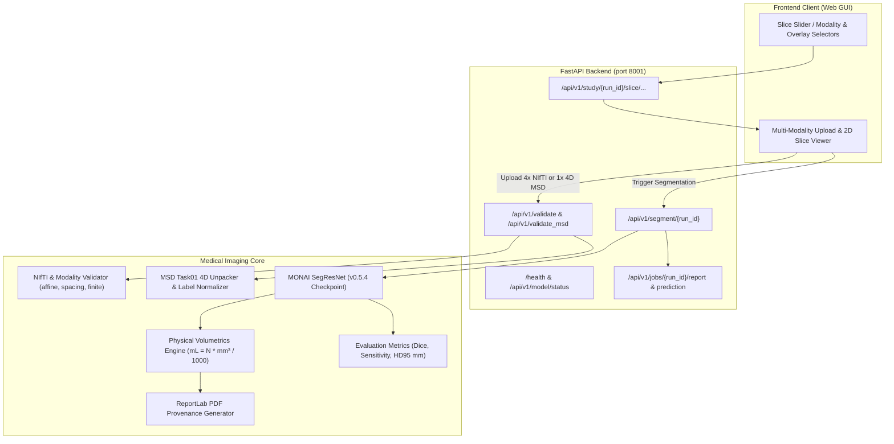

# NeuroScope 3D: Multimodal Brain Tumor Segmentation & Volumetrics

NeuroScope 3D is an academic, research, and educational platform for brain MRI validation, automated tumor subregion segmentation, physical volumetric quantification, and audited PDF reporting using the official **MONAI SegResNet** pretrained model bundle (`brats_mri_segmentation` v0.5.4).

> [!WARNING]
> **MANDATORY ACADEMIC & RESEARCH DISCLAIMER**  
> NeuroScope 3D is a research and educational prototype. It is **NOT** a medical device and has **NOT** received clinical clearance from the FDA, CE-MDR, or any health regulatory authority. It must **NOT** be used for clinical diagnosis, patient staging, surgical planning, or treatment decisions. All segmentation outputs and volumetrics are experimental and must be reviewed and verified by a board-certified neuroradiologist.

---

## 1. System Architecture & Data Flow



---

## 2. Key Capabilities & Specifications

- **Model Bundle:** Official MONAI Model Zoo bundle `brats_mri_segmentation` v0.5.4.
- **Architecture:** SegResNet (4 input channels, 3 output channels, `dropout_prob=0.2`).
- **Verified Checkpoint:** `backend/app/models/brats_mri_segmentation/brats_mri_segmentation/models/model.pt` (SHA-256: `860ccb3f1c21c99d0410ad8a1ac4ef6b8fab60cec0a503b0ba42675741a750ae`).
- **Supported Dataset Profiles:**
  1. `brats`: Standard 4 separate 3D NIfTI files (`t1`, `t1gd`, `t2`, `flair`) with discrete BraTS labels (0: Background, 1: NCR/NET, 2: ED, 4: ET).
  2. `msd_task01`: Medical Segmentation Decathlon Task01 BrainTumour 4D NIfTI volumes (shape `[X, Y, Z, 4]`). Automatically extracted and mapped (0: FLAIR, 1: T1, 2: T1gd, 3: T2) with MSD label conversion (1: Edema -> 2, 2: Non-enhancing -> 1, 3: Enhancing -> 4).
- **Physical Volumetrics:** Computes volumes in millilitres (mL) using exact NIfTI affine voxel dimensions ($V = N \times s_x s_y s_z / 1000$).
- **Spatial Slice Viewer:** Interactive 2D slice scrubber supporting Axial (Z), Coronal (Y), and Sagittal (X) views with blended color overlays:
  - 🔴 **Enhancing Tumor (ET):** Coral / Red (Label 4)
  - 🟡 **Tumor Core (NCR/NET):** Amber (Label 1)
  - 🟢 **Peritumoral Edema (ED):** Emerald / Green (Label 2)
- **PDF Report Generation:** Complete research report with model checkpoint SHA-256, scan provenance hash, volumetrics table, ground-truth metrics, and disclaimers.

---

## 3. Quickstart & Windows PowerShell Setup Guide

### Prerequisites
- Python 3.10+ (tested and verified on Python 3.14.3)
- Windows PowerShell

### Step 1: Activate Virtual Environment
```powershell
# Navigate to the repository root
cd c:\Users\vedan\OneDrive\Desktop\DevKraft\NeuroScope-3D

# Activate backend virtual environment
.\backend\venv\Scripts\Activate.ps1
```

### Step 2: Install Dependencies
```powershell
pip install -r backend/requirements.txt
```

### Step 3: Run Automated Test Suite
```powershell
# Run the complete test suite (all 41 unit and API tests pass)
pytest -v
```

### Step 4: Start the Backend API Server
> [!NOTE]
> On Windows, port `8000` is frequently occupied by background services or other local engines (triggering `WinError 10013`). The NeuroScope-3D backend is configured to run on port `8001`.

```powershell
cd backend
python -m uvicorn main:app --host 127.0.0.1 --port 8001 --reload
```

### Step 5: Access the Web Application & Documentation
- **Interactive Web Application:** Open [http://127.0.0.1:8001/app/](http://127.0.0.1:8001/app/) in your browser.
- **Interactive Swagger API Docs:** Open [http://127.0.0.1:8001/docs](http://127.0.0.1:8001/docs).
- **OpenAPI Schema:** [http://127.0.0.1:8001/openapi.json](http://127.0.0.1:8001/openapi.json).
- **Health Check Endpoint:** [http://127.0.0.1:8001/health](http://127.0.0.1:8001/health).

---

## 4. API Endpoints Reference

| Method | Route | Description |
|---|---|---|
| `GET` | `/health` or `/api/v1/health` | Comprehensive health check with model status and checkpoint SHA-256. |
| `GET` | `/api/v1/model/status` | Official MONAI bundle metadata and configuration. |
| `POST` | `/api/v1/validate` | Validates 4 separate 3D NIfTI modalities (`t1`, `t1gd`, `t2`, `flair`) and optional reference mask. |
| `POST` | `/api/v1/validate_msd` | Uploads and unpacks a 4D MSD Task01 case (`[X, Y, Z, 4]`) into the 4 required sequences. |
| `POST` | `/api/v1/segment/{run_id}` | Runs MONAI SegResNet sliding-window inference, computes volumetrics, and generates report. |
| `GET` | `/api/v1/study/{run_id}` | Fetches status, volume measurements, and evaluation metrics for a study. |
| `GET` | `/api/v1/study/{run_id}/slice/{modality}/{axis}/{idx}` | Renders a 2D MRI slice (PNG) with optional segmentation overlay and transparency control. |
| `GET` | `/api/v1/jobs/{run_id}/prediction` | Downloads the predicted 3D segmentation mask NIfTI file (`prediction.nii.gz`). |
| `GET` | `/api/v1/jobs/{run_id}/report` | Downloads the generated audited PDF report (`NeuroScope_Report.pdf`). |

---

## 5. MONAI Bundle Setup & Download Syntax

The verified model checkpoint is bundled in the repository at `backend/app/models/brats_mri_segmentation/...`.

If downloading or updating the bundle from scratch using the MONAI CLI:

```powershell
python -m monai.bundle download --name brats_mri_segmentation --version 0.5.4 --bundle_dir backend/app/models
```

---

## 6. Official Dataset Integration

### Medical Segmentation Decathlon (MSD) Task01 BrainTumour
- Download from the [Medical Segmentation Decathlon](http://medicaldecathlon.com/) archive (`Task01_BrainTumour.tar`).
- Extract the archive to a local scratch directory outside Git tracking.
- Scans inside `imagesTr/` are 4D NIfTI files containing 4 channels in order:
  - `0`: FLAIR
  - `1`: T1w
  - `2`: t1gd
  - `3`: T2w
- Reference masks inside `labelsTr/` use labels: `0`: background, `1`: edema, `2`: non-enhancing core, `3`: enhancing tumor.
- Use `/api/v1/validate_msd` or the **MSD Task01** tab in the web interface to automatically unpack and translate labels.

### BraTS 2018 / 2021
- Standard cases supply 4 separate files: `*_t1.nii.gz`, `*_t1ce.nii.gz`, `*_t2.nii.gz`, `*_flair.nii.gz`.
- Ground truth segmentation maps use labels: `1`: NCR/NET, `2`: ED, `4`: ET.
- Use `/api/v1/validate` or the **4-Modality BraTS** tab in the web interface.

---

## 7. Testing & Quality Assurance

To execute tests and verify full technical integrity:

```powershell
pytest -v
```

The test suite covers:
- Input validation (corrupted files, empty files, NaN/non-finite voxels, constant volumes, shape mismatches, affine mismatches).
- Modality mapping and channel order integrity.
- Dataset profile conversion (MSD Task01 label translation and 4D extraction).
- Physical volumetrics ($V = N \times s_x s_y s_z / 1000$) and composite region verification.
- Dice Similarity, Sensitivity, and 95th Percentile Hausdorff Distance (HD95 in mm).
- PDF report generation and metadata formatting.
- API endpoints (health, upload validation, MSD unpacking, inference, downloads, slice rendering).
- Genuine MONAI SegResNet model forward inference with the verified checkpoint.
