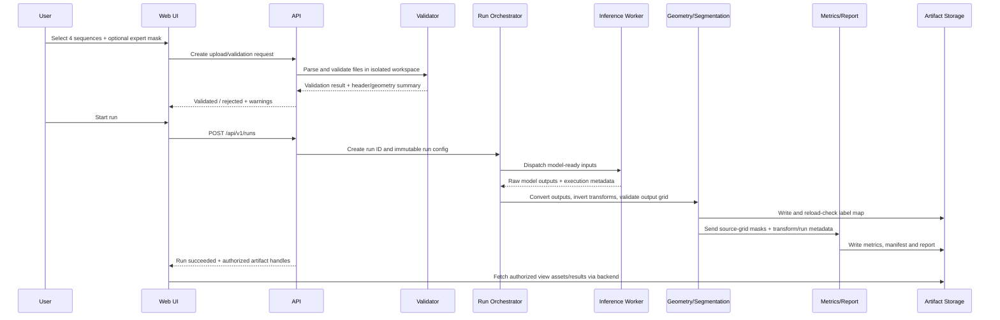

# NeuroScope 3D — System Architecture

> **Product direction:** Research-first medical-imaging platform with a staged path toward institutional research, multi-site validation, and—only if independently justified and authorized—a potential clinical product.
>
> **Architecture principle:** Correct geometry, traceable inference, controlled data handling, and verifiable behavior are first-class system capabilities. Visualization must never be allowed to hide a faulty pipeline.

| Document field | Value |
|---|---|
| Product | NeuroScope 3D |
| Document | `Architecture.md` |
| Version | 2.0 |
| Status | Proposed reference architecture; technology choices remain provisional until verified in the repository and deployment environment |
| Companion documents | [`prd.md`](./prd.md), [`Rules.md`](./Rules.md), [`Task.md`](./Task.md) |
| Current release boundary | R0 research/teaching prototype using permitted public, de-identified research data only |
| Architecture target | R0 through R5, with separate evidence and approval gates at each stage |
| Last reviewed | 16 October 2026 |

> **Important:** This document describes a target architecture, not a claim that any component has already been implemented, security-reviewed, validated, or authorized. Every implementation choice must be recorded in an Architecture Decision Record (ADR), tested against the actual model bundle and data, and reconciled with `prd.md` and `Rules.md`.

---

## 0. Purpose and architecture rules

This document translates the product requirements into a system design. It defines major components, responsibilities, data flows, trust boundaries, persistence, interfaces, deployment patterns, failure behavior, test strategy, and how the architecture evolves as the product matures.

### 0.1 Non-negotiable architecture principles

1. **Geometry before rendering.** Image shape, affine, orientation, voxel spacing and transform history must be validated and preserved. A visually plausible surface is not evidence of spatial correctness.
2. **Model outputs are not ground truth.** Prediction, expert reference, reviewer-edited annotation and uncertainty are different data objects and must stay distinguishable throughout the UI, APIs and reports.
3. **Inference is reproducible.** Every successful run must identify the input content, model artefact, model configuration, preprocessing, post-processing, code/container revision, runtime environment and outputs.
4. **The output contract is explicit.** Model logits or nested WT/TC/ET masks must not be silently treated as component-coded NCR/ED/ET labels. Label-map conversion is a separately tested module.
5. **Invalid input cannot produce a result.** Validation and run state must prevent stale predictions, partial output files, or a failed run from being presented as successful.
6. **Data rights determine deployment.** A technical ability to process a dataset does not grant permission to do so. Retention, access, hosting, export and reuse are configurable only within approved policies.
7. **Start simple; keep boundaries clean.** Use a modular monolith plus an isolated inference worker initially. Do not create microservices without a measured need or required security boundary.
8. **Future scope is gated.** R1–R5 architecture capabilities are design targets. They must not be enabled or advertised until the relevant data, security, scientific, institutional and regulatory gates are passed.
9. **Evidence outranks status labels.** A component is not considered production-ready because it is deployed or has a green UI; its required tests and approvals must exist.

### 0.2 Requirement language

- **MUST:** required in the applicable release stage.
- **SHOULD:** recommended unless a documented decision justifies deferral.
- **MAY:** optional.
- **TBD:** must be resolved by the accountable owner; do not guess.
- **R0–R5:** maturity stages from `prd.md`.

## 1. Architecture objectives and boundaries

### 1.1 System objectives

- Accept four mapped NIfTI MRI sequences—T1, T1Gd/T1c, T2 and FLAIR—with an optional expert mask.
- Validate data and image geometry before inference.
- Run a pinned, licensed 3D segmentation model in a controlled worker.
- Map valid predictions to the required source image grid and affine.
- Provide interactive 3D visualization and linked orthogonal slices with correct coordinate semantics.
- Calculate physical volume from the voxel mask and affine, not from rendered mesh volume.
- Support research evaluation, comparison, cohort operations and versioned model experiments in later stages.
- Produce a report and machine-readable run manifest with provenance, limitations and warnings.
- Keep uploaded data and derivatives within the approved storage and retention boundary.
- Support future institutional deployments without coupling the core imaging algorithms to one cloud, identity provider or web framework.

### 1.2 Outside the current R0 boundary

R0 does not authorize real-patient data, clinical decision-making, diagnosis, tumour grading, genetic prediction, prognosis, treatment advice, surgical/radiotherapy planning, routine hospital use, PACS write-back or claims of clinical validation. DICOM, multi-user research workspaces, clinical-study workflow, and regulated-product controls are later-stage capabilities. A disclaimer is not a substitute for a regulatory or intended-use assessment.

### 1.3 Architectural quality attributes

| Attribute | R0 expectation | R1/R2 research expectation | R3+ expectation |
|---|---|---|---|
| Correctness | Valid NIfTI output, labels, affine and metrics | Regression coverage and reproducible experiments | Multi-site conformance and independently reviewed evidence |
| Reproducibility | Model/config/input hashes and deterministic settings where possible | Immutable run manifests and cohort/experiment versioning | Locked study configurations and audit-ready evidence |
| Security | Safe local/controlled upload, no external scan API | Authentication, authorization, audit, backup and recovery | Institution/site isolation, integration threat models and formal reviews |
| Privacy | Public de-identified data; challenge retention rules | Approved research policy and controlled data lifecycle | Agreements, institution governance and study-specific permissions |
| Performance | One case within the challenge's two-minute target on specified GPU | Bounded batch scheduling and measurable throughput | Site workload, service capacity and recovery targets established by evidence |
| Maintainability | Modular code and pinned environment | CI, migrations, runbooks and controlled releases | Formal change-impact assessment and quality lifecycle processes as applicable |
| Interoperability | NIfTI input/output | Stable versioned APIs | DICOM/DICOMweb and selected FHIR mappings after conformance review |

## 2. Recommended architectural style

### 2.1 R0–R1: modular monolith plus separate inference worker

The recommended initial design is a **modular monolith for application APIs and orchestration**, a **separate inference worker process**, and an explicit storage abstraction. This keeps implementation complexity manageable while preventing GPU/ML runtime concerns from infecting UI and API logic.

A single-process prototype can be used for an early spike if needed, but the inference, image geometry, validation and metric modules should still have clean interfaces. Before handling multiple users or persistent research data, isolate inference execution and file processing from the web request process.

Benefits:
- fewer deployment units than a premature microservice design;
- testable module boundaries;
- direct integration with Python medical-image and ML libraries;
- ability to run the same imaging pipeline from CLI, API and tests;
- clear route to a queue/worker architecture as jobs become longer or more concurrent.

### 2.2 When to split components into services

Split a module into a separately deployed service only when one or more of the following has been demonstrated:
- independent scaling or GPU scheduling is required;
- separate privilege or network boundaries are required;
- deployment/availability needs differ materially;
- institution integration mandates isolation;
- a measured bottleneck cannot be handled with bounded workers within the existing application;
- ownership and operational responsibility are clear.

Do not split services merely because the diagram looks more sophisticated. Every service adds deployment, authentication, observability, version compatibility and recovery obligations.

## 3. System context

```mermaid
flowchart TB
    RU[Research user / educator] -->|HTTPS or local browser| WEB[NeuroScope web application]
    OP[Research administrator] -->|Authorized administration| WEB
    WEB --> API[Application API and orchestration]
    API --> PROC[Image validation and processing pipeline]
    PROC --> MODEL[Versioned inference worker]
    PROC --> ART[Prediction, mesh, report and run manifest]
    API --> META[(Metadata database: R1+)]
    API --> AUD[Audit trail: R1+]
    ART --> STOR[(Controlled local/object storage)]
    WEB -->|Authorized result access| API
    DATA[Permitted public research data / approved import] -. controlled import .-> PROC
    subgraph Future integrations — disabled until approved
      PACS[PACS / DICOMweb]
      FHIR[Institution FHIR service]
      IAM[Institution identity provider]
    end
    PACS -. R3+ adapter .-> PROC
    FHIR -. selected metadata exchange .-> API
    IAM -. R1+ identity integration .-> API
```

External systems in the dashed section are future integrations, not enabled R0 dependencies. No external service should receive MRI data unless a future deployment has an approved data flow, contractual basis, security assessment and explicit technical configuration.

## 4. Container and deployment view

### 4.1 Logical containers

| Container | Responsibility | Suggested implementation | Trust/access boundary |
|---|---|---|---|
| Web client | Upload, viewer, controls, results and report display | React + TypeScript | Browser; no direct filesystem or database access |
| API/application | Authentication integration, authorization, validation orchestration, run lifecycle, report access | Python + FastAPI (provisional) | Validates every request; never trusts frontend role checks |
| Imaging pipeline library | NIfTI parsing, checks, transforms, post-processing and geometry | Python; NiBabel/SimpleITK as appropriate | Runs under constrained process/resources for untrusted files |
| Inference worker | Loads model and performs GPU/CPU inference | MONAI/PyTorch model runtime (provisional) | Isolated worker; restricted filesystem and network |
| Job scheduler/queue | Queues and leases long-running jobs | R0: bounded in-process/local queue; R1+: Redis/RQ, Celery or institutional scheduler after decision | Jobs are idempotent/lease-aware; no trusting client-supplied paths |
| Metadata store | Users/projects/cases/runs/config references and status | R0: simple local metadata only if needed; R1+: PostgreSQL candidate | Not publicly exposed; server-side authorization required |
| Artifact storage | Inputs, intermediate files, predictions, manifests, reports and meshes | R0: isolated temporary directory; R1+: controlled local/object storage | Separate storage namespace per project/run; encryption/access policy by deployment |
| Model registry | Immutable model artefact and configuration records | R0: pinned local bundle; R1+: registry/metadata table and controlled artefact store | Only approved/licensed models can be marked active |
| Audit/observability | Minimal structured operational logs and security/audit events | Structured logs, metrics, append-only audit store for R1+ | No raw voxels or unnecessary identifying metadata in logs |

The table is a logical decomposition. Some containers may initially be deployed together, provided module and privilege boundaries are not lost.

### 4.2 Suggested deployment profiles

**Developer/demo profile (R0)**
- local browser and backend on a controlled machine or permitted private host;
- one bounded inference worker;
- public, de-identified research inputs only;
- isolated temporary run directories and automatic cleanup within the challenge's 24-hour limit;
- no external telemetry containing input content;
- simple setup/start and prediction commands.

**Single-lab research profile (R1/R2)**
- institution-approved VM, server or on-premises environment;
- institution identity integration where practical;
- persistent metadata store and approved artifact storage;
- project/role-level authorization;
- job queue, bounded concurrency, backup/restore and operational runbooks;
- policy-configured retention, export approvals and audit events.

**Multi-site research profile (R3)**
- deployment per site or institution-controlled boundary as required;
- site-level storage/identity/network controls;
- explicit data-sharing or federated-analysis design;
- documented DICOM conversion/conformance profile if DICOM is used;
- external validation configuration frozen and traceable;
- cross-site transfer disabled by default until approved.

**Investigational or potential regulated profile (R4/R5, future-gated)**
- separate approved deployment configuration and locked release artefacts;
- formal risk controls, change control, verification/validation and monitoring appropriate to intended use;
- study-specific access, protocol and audit requirements;
- documented recovery, rollback, incident handling and model change processes;
- no activation based solely on a feature flag or disclaimer. Required institutional, ethics, regulatory and quality approvals must be recorded.

## 5. Component architecture and responsibilities

### 5.1 Frontend modules

| Module | Responsibilities | Must not do |
|---|---|---|
| Upload wizard | Collect four sequence files, identify sequence mapping, optional reference mask, show validation summary | Decide that an image is valid based only on file extension or client MIME type |
| Processing status | Show server-reported states/stages, elapsed time, warnings and safe retry behavior | Announce success before server verifies complete outputs |
| Case workspace | Keep selected case/run, selected region and crosshair state coherent | Invent spatial coordinates or transform image arrays without matching geometry operations |
| Slice viewer adapter | Render axial/coronal/sagittal views and overlays using geometry-aware library APIs | Assume array order equals anatomical orientation |
| 3D viewer adapter | Render brain surface/segmentation meshes and controls | Use mesh volume as the authoritative region volume |
| Metrics panel | Display volumes, comparison metrics, uncertainty method and availability states | Show comparison metrics when no valid expert reference exists |
| Provenance panel | Show model, configuration, input hashes, warnings and run details | Hide unknown or missing provenance fields |
| Export/report panel | Request authorized report and mask downloads | Construct file paths or bypass server-side authorization |
| Research workspaces (R1+) | Project, cohort, run history and role-specific navigation | Treat a hidden UI element as an authorization control |

### 5.2 Backend modules

Organize modules by domain, not only by framework layer. Keep core algorithms importable without starting the web server.

- `api/`: versioned route definitions, schemas, authentication middleware and structured errors.
- `auth/`: identity-provider adapter, session/token validation and permission checks (R1+).
- `projects/`: research projects, membership and role policy (R1+).
- `datasets/`: dataset/source registers, licences, manifests, cohort versions and lineage.
- `cases/`: pseudonymous case metadata and sequence inventory.
- `uploads/`: streaming upload, size limits, generated storage names, cleanup registration.
- `validation/`: parser checks, numeric values, dimensions, affine, spacing and input suitability.
- `imaging/`: NIfTI/DICOM adapters, header policy, orientation and grid conversion.
- `preprocessing/`: model-specific transforms and transform record.
- `models/`: model registry, licence/provenance, configuration and active-version selection.
- `inference/`: worker dispatch, device selection, model loading and execution lifecycle.
- `segmentation/`: output interpretation, thresholds, mask nesting and BraTS component-label contract.
- `geometry/`: affine/world/voxel transform helpers, mesh coordinate transforms and orientation utilities.
- `metrics/`: physical volumes, Dice, sensitivity, HD95 and predefined empty-mask policy.
- `experiments/`: evaluation protocol, split manifests, runs, comparison and batch processing (R2+).
- `annotations/`: reference labels, reviewer edits, adjudication and annotation versioning (R1+).
- `reporting/`: human-readable report, machine-readable manifest and output checksums.
- `storage/`: temporary workspaces, persistent artifact storage and retention/deletion jobs.
- `audit/`: security/data access/export events, separate from normal diagnostic logs.
- `operations/`: health, readiness, resource limits, job expiry and recovery hooks.

### 5.3 Core module contracts

- The **validation module** returns either a structured validation result with warnings, or a failure set. It does not run model inference.
- The **preprocessing module** returns model-ready tensors plus a serializable transform record needed to map predictions back.
- The **inference module** returns documented raw model outputs and model/runtime metadata. It does not write the final user-facing label map without the segmentation postprocessor.
- The **segmentation module** converts raw outputs into defined masks or component labels and validates invariants.
- The **geometry module** owns all voxel/world coordinate conversion logic. UI components must not reimplement affine math independently.
- The **metrics module** calculates from source-grid masks and physical geometry. It does not calculate volume from a mesh.
- The **reporting module** consumes a completed immutable run result; it does not independently rerun inference.
- The **storage module** enforces expiry, isolation and access policy; feature code should not construct arbitrary paths itself.

## 6. End-to-end data and control flow

### 6.1 R0 single-case workflow



Failure in any required stage transitions the run to `failed` or `rejected`; the system must not publish a success report or reuse a previous case's artifacts. Cleanup executes according to the active retention policy.

### 6.2 Processing states

Recommended state model:

`created → uploading → validating → rejected | queued → preprocessing → inference → postprocessing → metrics → report_generation → succeeded`

Any running state may transition to `failed` or a controlled `cancelled` state where cancellation is supported. State transitions must be persisted for R1+ and exposed consistently to UI and API.

Rules:
- A terminal state is immutable except for an explicit administrative correction event; reruns create new run IDs.
- A failed attempt must not overwrite the last successful artifact for a different run.
- `succeeded` means prediction NIfTI and required metadata were re-opened/validated, and required report artifacts exist.
- Progress percentages are optional. If exact progress cannot be measured, report a stage instead of fake precision.
- A timeout does not automatically mean the worker stopped; worker termination and output cleanup must be verified.

## 7. Medical-imaging pipeline architecture

### 7.1 Sequence mapping and input contract

The R0 interface accepts four sequences: T1, T1Gd/T1c, T2 and FLAIR. Sequence mapping is explicit and stored in the run manifest. Filename inference may suggest a mapping but must be confirmed or safely validated. A case is not considered valid merely because four files were uploaded.

Each input asset record should capture:
- generated asset ID and storage key;
- original filename only where needed and under a safe logging policy;
- sequence label and mapping source (user-confirmed or inferred);
- checksum (SHA-256) calculated server-side;
- byte size, parser result, dimensions and datatype;
- spacing and selected affine summary;
- qform/sform presence and any inconsistency warning;
- intensity finite/constant checks;
- validation status and warnings;
- applicable dataset/source/license reference.

### 7.2 Validation order

1. Enforce request and per-file size limits before expensive parsing; account for compressed-file expansion and total request size.
2. Generate a server-controlled name and isolated workspace; never use the uploaded path as a filesystem path.
3. Verify that the content can be parsed as NIfTI rather than trusting extension or MIME type.
4. For `.nii.gz`, verify gzip decompression and NIfTI parsing safely.
5. Require supported 3D input. Unsupported dimensions must fail clearly unless a later version explicitly defines 4D handling.
6. Reject NaN/infinite values and constant volumes.
7. Validate positive usable spacing, selected affine and header metadata.
8. Compare required sequence shapes and spatial affines within a documented, tested tolerance.
9. Apply supported brain/skull-stripping suitability checks; label heuristics as warnings, not definitive anatomical classification.
10. Validate expert-mask label values and its alignment with the case reference grid.
11. Only then mark the case inference-ready.

All file parsing must run within resource limits. If parser time, expansion size, array shape or memory demand exceeds policy, fail safely.

### 7.3 Coordinate and affine policy

Let `A` be the selected 4×4 NIfTI voxel-to-world affine. For voxel index `(i, j, k)`:

`world_mm = A × [i, j, k, 1]^T`

For a world point, use the inverse affine to obtain continuous voxel coordinates, then apply a documented rounding/bounds policy for indexing.

Architecture rules:
- Use one geometry service/library wrapper for transformations; do not maintain multiple independent implementations in the frontend and backend.
- Inspect qform/sform codes and matrices. When coded transforms materially disagree, warn or reject under a documented policy rather than silently guessing.
- Shape equality is not proof of spatial alignment.
- Do not apply left-right array flips as a display fix unless the coordinate transformation is explicitly applied and recorded in the data pipeline.
- Keep physical-space meshes, slice views, marker points and reported coordinates in a single documented world convention.
- Record any reorientation, resampling, crop, pad and inverse transform.
- Choose and test affine comparison tolerance against representative fixtures; do not embed an untested “universal” tolerance.

### 7.4 Model-specific preprocessing

All preprocessing behavior must be defined by the exact pinned model bundle and configuration, not guessed from a generic architecture name. Capture:
- channel order;
- target orientation and voxel spacing;
- intensity normalization per modality;
- crop/pad policy;
- inference tile/window size and overlap if applicable;
- threshold and post-processing policy;
- transform inversion strategy;
- software/model revisions.

The challenge description identifies the MONAI BraTS MRI Segmentation SegResNet bundle as using channel order T1Gd/T1c, T1, T2, FLAIR at 1 mm and outputs TC, WT and ET. These details must be confirmed against the exact model bundle and revision used. Never assume MONAI's framework licence is the same as the weights/bundle licence.

### 7.5 Output-label semantics — critical boundary

BraTS 2021 reference/component label codes are `0=background`, `1=NCR`, `2=ED`, `4=ET`. Derived masks are:
- `WT = NCR ∪ ED ∪ ET`
- `TC = NCR ∪ ET`
- `ET = ET`

The MONAI bundle named in the challenge is described as predicting nested TC, WT and ET regions. Nested region masks do not uniquely determine the separate NCR and ED component labels in every voxel. Therefore:

1. Inspect the actual model outputs and bundle documentation before implementing conversion.
2. Define the model-to-display mask mapping and model-to-component-label mapping separately.
3. Do not fabricate a three-way NCR/ED/ET split if the model does not predict enough information to support it.
4. If the judge scorer requires component-coded output, implement a justified and documented conversion consistent with the available model/data contract, or select a compatible model. Explicitly record any limitation.
5. Test that output values are limited to `{0,1,2,4}`, derived region nesting is valid, and the output shape/affine match the reference grid.
6. Reload the saved NIfTI and repeat validation before declaring success.

A label-coded file that merely contains WT/TC/ET encoded as if they were NCR/ED/ET is invalid, even if the 3D viewer looks correct.

### 7.6 Inference execution

- Model artefacts are immutable, checksummed and loaded from a controlled path.
- The worker receives validated inputs and a named model/configuration, not arbitrary user paths or arbitrary Python code.
- Limit concurrent jobs according to GPU memory and measured throughput.
- Record device type, software versions, batch/window settings, runtime and warnings.
- Use deterministic settings where available and meaningful; measure mask reproducibility rather than assuming determinism.
- Model loading failures, OOM, CUDA errors and worker crashes must transition to failed state with cleanup and structured errors.
- Do not retrieve stored evaluation images/labels at inference. Model files and documented configuration are allowed; hidden-case lookup is not.

## 8. Segmentation, metrics and visualization architecture

### 8.1 Source-of-truth objects

Maintain distinct artefacts:
- **Source image volumes:** original uploaded MRI files and their validated headers.
- **Processed tensors:** worker input, normally temporary; exact retention depends on approved policy.
- **Raw model output:** logits/probabilities/masks in model space where permitted and useful for reproducibility.
- **Source-grid label map:** finalized voxel label map with the required affine.
- **Derived region masks:** WT, TC and ET masks derived from the explicitly defined component map or model semantics.
- **Expert reference mask:** user-supplied reference, never overwritten by prediction.
- **Reviewer annotation:** a new version with author/reviewer and lineage, not an edit in place to the expert source.
- **Display mesh:** derivative generated from a mask for rendering; not an authoritative metric source.
- **Metrics and report:** immutable outputs associated with a run and the exact reference/metric protocol.

### 8.2 Volume engine

For a binary region mask `M` and affine `A`:

`voxel_count = count_nonzero(M)`

`voxel_volume_mm3 = abs(det(A[0:3, 0:3]))`

`estimated_volume_mL = voxel_count × voxel_volume_mm3 / 1000`

Volume is computed from the final source-grid voxel mask, not a mesh. The report should include voxel count, voxel volume, formula, region definition, affine/grid reference and displayed rounding. When expert and predicted masks are both available, produce separate volumes with labels identifying which is which.

### 8.3 Metrics engine

For prediction `P` and expert reference `G`:

- `Dice = 2 × |P ∩ G| / (|P| + |G|)`
- `Sensitivity = |P ∩ G| / |G|`

Metric policies must define empty-mask behavior, thresholding, resampling rules and aggregation. In R0, match the organizers' scorer where specified. In R2+, freeze analysis plans and cohort splits before comparing models. HD95 is optional and must be computed in physical millimetres with a documented surface/distance convention.

### 8.4 Uncertainty and quality indicators

Uncertainty can be evaluated with test-time augmentation or an ensemble if latency and data justify it. Keep these concepts distinct:
- model probability/logit;
- prediction instability under a specified perturbation/ensemble;
- expert disagreement;
- input quality warning;
- out-of-distribution indicator.

Do not label a quantity “confidence” unless its meaning and calibration evidence support that wording. Uncertainty estimates do not establish correctness. The selected method, number of forward passes, thresholds, calibration evidence and limitations belong in the run manifest.

### 8.5 Viewer state and geometry boundary

The frontend should consume a canonical geometry descriptor from the backend or imaging adapter:
- source dimensions and spacing;
- source affine and its coordinate convention;
- orientation codes;
- crosshair voxel and world coordinates;
- view-to-world transforms;
- links to masks, meshes and source images.

The slice viewer and 3D viewer must share the same canonical world point. Use one typed state model for current case/run, selected region, opacity, camera reset, crosshair and slice positions. If a viewer library requires a different convention, implement and test a single adapter rather than scattering conversion logic through components.

Crosshair clicks, keyboard slice navigation and 3D picking must round-trip through world/voxel conversion and pass known-marker fixtures. Left/right labels are derived from geometry and tested under orientation transforms.

## 9. API and internal contracts

The specific paths below are a proposed contract. The OpenAPI schema and implementation must be kept in sync; any breaking change requires an API version or an approved migration plan.

### 9.1 R0–R1 API surface

| Method | Path | Purpose | Success behavior |
|---|---|---|---|
| `GET` | `/api/v1/health` | Basic process health | No sensitive configuration returned |
| `GET` | `/api/v1/ready` | Readiness: dependencies/model configuration usable | Reports only safe readiness status |
| `POST` | `/api/v1/validate` | Validate mapped sequences and optional expert mask | Returns validation summary and warnings; no inference |
| `POST` | `/api/v1/runs` | Create an inference run using an approved model/configuration | Returns `run_id` and state; typically `202 Accepted` for async processing |
| `GET` | `/api/v1/runs/{run_id}` | Read run status and summary | Authorized status and stage, errors or completed summary |
| `GET` | `/api/v1/runs/{run_id}/prediction` | Download source-grid label map | Authorized attachment plus content/checksum metadata |
| `GET` | `/api/v1/runs/{run_id}/report` | Download report and manifest | Authorized report for successful run only |
| `GET` | `/api/v1/models` | List available model versions | Only model versions allowed in current deployment/stage |

R1+ adds authenticated project/case/dataset/cohort/annotation/experiment endpoints. Avoid designing all future endpoints now; define them when requirements, access policy and data model are approved.

### 9.2 Run creation behavior

A run request must specify or resolve:
- validated case/run input reference;
- a model registry identifier and immutable model version;
- a configuration version or hash;
- optional expert-mask reference for comparison;
- project/experiment context where available;
- request idempotency key when clients may retry a request after a timeout.

The client must not send an arbitrary filesystem path, an arbitrary Python object, or an untrusted model URL for the server to load. Server authorization and model allow-list checks are mandatory in persistent environments.

### 9.3 Error response

Use stable error codes and actionable messages. Example:

```json
{
  "error": {
    "code": "AFFINE_MISMATCH",
    "message": "The T2 volume is not aligned with the selected reference volume.",
    "action": "Confirm that all sequences belong to the same co-registered research study.",
    "run_id": null,
    "details": { "sequence": "T2" }
  }
}
```

Do not return raw voxel data, credentials, internal stack traces or arbitrary absolute paths. Internal diagnostics may be stored in a protected log with run ID and safe metadata.

### 9.4 Artifact download controls

- Use opaque artifact IDs or short-lived authorized download handles.
- Check current user/project permission on every download, not only when a result list is rendered.
- Never trust user-provided storage keys.
- Use content types, download filenames and disposition headers safely.
- Make expiry and deletion behavior observable to authorized operators.

## 10. Data architecture and persistence

### 10.1 Data classes

| Class | Examples | R0 handling | R1+ handling |
|---|---|---|---|
| Source imaging | T1, T1Gd, T2, FLAIR, expert mask | Isolated temporary workspace; permitted public/de-identified data only | Institution-approved storage and policy-driven lifecycle |
| Derivative imaging | normalized volumes, tensors, masks, meshes | Temporary unless required as output | Retention defined by research protocol and data owner |
| Model artefacts | weights, config, transforms | Pinned controlled local artefact | Versioned registry and controlled access |
| Run metadata | state, hashes, timings, versions, metrics | Small local manifest or metadata record | Database-backed versioned history and access control |
| Reports | PDF/HTML and machine-readable manifest | Downloadable run output, subject to challenge cleanup rules | Controlled exports with permissions and retention policy |
| Audit/security events | logins, downloads, changes, access decisions | Minimal operational log; avoid sensitive content | Append-only security/data-access audit with controlled access |
| Identifiers | random case/run IDs | No patient identity collection | Pseudonymous research IDs; linkage held separately by authorized institution if ever required |

### 10.2 Core entities

Future-ready entities should include:

- `Organization` — deployment/tenant boundary, policy references and status.
- `User`, `Role`, `Membership` — identity and role binding.
- `Project` / `Study` — purpose, owner, protocol reference, status and permissions.
- `Dataset` and `DatasetVersion` — source citation, terms, licence, permitted purpose, manifest and content version.
- `Case` — pseudonymous research case linked to a dataset version.
- `ImagingAsset` — sequence, storage reference, checksum, size, dimensions, spacing, affine summary, status and retention class.
- `AnnotationVersion` — reference or reviewer annotation, label schema, author/role, version and adjudication status.
- `ModelVersion` — model source, licence, revision, checksum, input/output specification and intended scope.
- `InferenceConfig` — preprocessing, channel order, threshold, post-processing, runtime and version hash.
- `Run` — input references/hashes, model/config, state, timings, warnings, outputs and creator.
- `MetricResult` — metric, region, prediction/reference versions, protocol, value and aggregation context.
- `ReportArtifact` — run reference, version, checksum, created time and access policy.
- `AuditEvent` — actor, action, object, timestamp, outcome and minimal relevant context.

IDs must not assume that a research case ID equals a patient ID. Do not create an identity-linkage field in R0 simply for future flexibility.

### 10.3 Object storage and database responsibilities

Store relational metadata and state in the metadata store; store large NIfTI files, masks, meshes and reports in file/object storage. Store small test fixtures in the repository only when rights and size permit. Do not place raw MRI arrays in relational records or logs.

The metadata database is the source for run state and references, not the source of truth for actual artifact bytes. Artifacts must have checksums and immutable version identifiers. The system should detect missing/corrupt stored artifacts and mark the run/report as unavailable rather than silently regenerate something with different model code.

### 10.4 Retention and deletion

Retention is policy-driven by deployment stage and legal/data agreements. R0 must comply with the challenge's deletion requirement (uploads within 24 hours). R1+ may retain data only when the responsible institution has approved the purpose, policy, access and retention schedule. Do not interpret a future research-platform roadmap as blanket permission to retain, train on, or redistribute uploaded files.

Deletion needs to cover primary object, temporary staging, derivatives, cached previews and applicable replicas/backups according to approved policy. If immediate physical deletion from backups is not supported, document the backup lifecycle and ensure expired objects cannot be restored into active use without policy controls.

## 11. Identity, authorization and audit

### 11.1 Stage policy

- **R0:** single-user or controlled demo flow; no real patient data; keep interface and deployment private where possible.
- **R1:** authentication, server-side authorization, project memberships, least privilege, session controls and audit of sensitive actions.
- **R2:** separate dataset-management, experiment-run, reviewer and export permissions.
- **R3:** site-level boundary, approved inter-site transfer and external identity integration as needed.
- **R4/R5:** additional controls defined by approved study, risk management and intended-use requirements.

### 11.2 Authorization rules

- The server makes every access decision; frontend route guards are only usability aids.
- Deny access by default.
- Check organization, project and object access on reads, writes, runs, annotation edits, report exports and deletes.
- A user's permission to view a case must not automatically imply permission to export raw imaging or modify an expert mask.
- Model registration, model activation, threshold/configuration change, deletion policy change and role administration require explicit privileges and audit events.
- Privileged access should be limited, reviewed and disabled when no longer needed.

### 11.3 Audit versus provenance

Keep separate concepts:
- **Operational log:** what the application/worker did to troubleshoot performance and errors.
- **Security/audit event:** who accessed/exported/changed an object and whether the action succeeded.
- **Run provenance:** which exact inputs, model/configuration, code and transformations produced an output.

These records overlap but are not interchangeable. Audit logs should be append-only or protected against ordinary modification for R1+; provenance is versioned with the run; operational logs must be minimized and must not contain raw imaging data.

## 12. Model registry and AI lifecycle

### 12.1 Model version record

Each model version should include:
- immutable model ID and version/revision;
- artefact checksum;
- source URL and date/eligibility context where needed;
- licence and dependency/licence review status;
- architecture/framework/runtime version;
- training-data description and known/unknown overlap with evaluation cases;
- intended task and known limitations;
- input modalities and exact channel order;
- normalization, orientation, spacing, crop/pad and inference method;
- output tensor shape/semantics and mapping to display/output labels;
- evaluation dataset, split, metrics and protocol references;
- approval status for each product stage.

### 12.2 Model release states

Recommended states:

`proposed → licence_review → technical_validation → research_approved → deprecated | rejected`

For future regulated work, the model state machine must be expanded to match the formal quality and regulatory processes chosen by the responsible organization. `research_approved` does not mean clinically authorized.

### 12.3 Model/configuration change impact

Any change to weights, library version, preprocessing, orientation transform, inference windows, thresholds, post-processing, label conversion or metric handling can change results. Treat these as versioned changes, create a new run identity, and decide whether regression tests or re-evaluation are required. Never mutate an existing model version in place.

### 12.4 Reproducibility manifest

A successful run manifest should include at least:

```json
{
  "schema_version": "1.0",
  "run_id": "opaque-run-id",
  "created_at": "ISO-8601 timestamp",
  "input_assets": [
    {"sequence": "T1", "sha256": "...", "shape": [240, 240, 155], "spacing_mm": [1, 1, 1]}
  ],
  "reference_grid": {"shape": [240, 240, 155], "affine_sha256": "...", "world_convention": "documented convention"},
  "model": {"id": "...", "version": "...", "artifact_sha256": "...", "license": "..."},
  "configuration": {"id": "...", "sha256": "...", "channel_order": ["T1Gd", "T1", "T2", "FLAIR"]},
  "software": {"git_commit": "...", "container_digest": "...", "runtime_versions": {}},
  "transforms": [],
  "outputs": [{"type": "nifti-label-map", "sha256": "...", "shape": [240, 240, 155]}],
  "warnings": [],
  "metrics_protocol": null
}
```

This is an illustrative schema, not a finalized API. Avoid embedding identifiable metadata or exposing full file paths. Missing values should be explicit (`null`/`not recorded`) rather than invented. For a real implementation, define JSON Schema and version it.

## 13. Research operations architecture (R1/R2)

### 13.1 Project workspaces

R1 should introduce a workspace boundary with project membership, data-use purpose, dataset references, runs, annotations, reports and retention policy. Each object must be checked against project membership and role permissions. Do not create a workspace merely as a visual folder while files remain globally accessible.

### 13.2 Dataset and cohort registry

A dataset registry should preserve source citation, data licence/terms, acquisition date, permitted uses, version/manifest, exclusions and lineage. A cohort is a reproducible selection manifest, not a mutable database query whose membership silently changes over time. Store patient-level split assignments where permitted and ensure patch/slice derivatives cannot leak across train/validation/test splits.

### 13.3 Batch processing

Batch execution requires:
- bounded concurrency and queue quotas;
- per-case independent run state;
- failure isolation so one corrupt case does not invalidate all other results;
- complete record of attempted, succeeded, failed, skipped and excluded cases;
- retries that do not duplicate outputs or change run identity unexpectedly;
- cohort, model and config versions pinned before execution;
- per-case outputs plus transparent aggregates, missingness and failure summaries.

Do not present only average Dice if per-case failures or cohort exclusions are material. Report metric distribution and data coverage where appropriate.

### 13.4 Experiment tracking

Each experiment should version the cohort, split, model version, inference configuration, metric definitions and analysis plan. If thresholds or model configurations change after looking at held-out test results, mark that data as used for tuning and select a new independent holdout for final evaluation where possible.

### 13.5 Annotation workflow

Annotations must be versioned. An expert reference, independent reviewer annotation, adjudicated reference and AI prediction must remain distinct. Edits must create a new annotation version, identify author/role and timestamp, record the label schema, and preserve parent lineage. Never silently overwrite the only copy of a reference annotation.

## 14. Multi-site and interoperability architecture (R3)

### 14.1 Site boundary

For multi-site research, decide whether each institution runs a separate local instance, whether an institution-controlled central environment is permitted, or whether a federated workflow is needed. The choice depends on data agreements, law, bandwidth, institutional policy and research design. Do not assume central cloud storage is acceptable for every site.

A site manifest should identify site code, data version, scanner/protocol metadata allowed for analysis, conversion pipeline and approved transfer method. Direct identifiers and local linkage keys should remain under the site's control unless an approved agreement explicitly provides otherwise.

### 14.2 DICOM and DICOMweb adapter

DICOM support is not simply “accept DICOM files.” It requires a defined conformance profile and tests for series selection, orientation, spacing, Frame of Reference, de-identification, pixel data, compressed transfer syntaxes and derived objects.

Recommended path:
1. Start with read-only DICOM import in a sandbox.
2. Select series using explicit study/series selection rules, not “first series found.”
3. Validate image geometry, modality, acquisition consistency and expected sequence semantics.
4. De-identify metadata and inspect pixel data for burned-in identifiers where required.
5. Convert to an internal image representation with complete source/transform lineage.
6. Verify output coordinates and overlays against known DICOM fixtures.
7. Add DICOM SEG export only after output geometry, segment coding, source-image references, and target-system interoperability tests are implemented.
8. Add PACS write-back only after separate institutional approval, access controls, audit, failure recovery and conformance testing.

DICOM SEG defines a segmentation object linked to referenced images and their spatial context; a generic NIfTI mask renamed as DICOM is not conformant. DICOMweb services are standardized separately in DICOM PS3.18. Consult the current official specification and target institution's conformance statement before implementation.

### 14.3 FHIR metadata integration

FHIR may be used for selected metadata exchange when a real institutional use case exists. `ImagingStudy` represents information about a DICOM imaging study; it does not itself store all image instances. FHIR `Provenance` and `AuditEvent` address related but different accountability needs. Choose a specific FHIR release, profiles, resource relationships and authorized server before implementation.

Do not use FHIR resources as an excuse to send imaging data to an external service. FHIR integration requires authentication, authorization, patient/organization consent or policy basis where applicable, audit, rate limits and a documented data-flow review. A research segmentation result should not automatically be transformed into a diagnostic `DiagnosticReport` or inserted into a patient record unless a future approved workflow explicitly requires it.

### 14.4 Data transfer patterns

Preferred patterns, in order to be assessed for each study:
- local processing at the site with approved aggregate export;
- transfer of permitted de-identified data to an approved controlled environment;
- federated analysis when local-data constraints require it and the analysis is technically valid.

Federated analysis is not a magical privacy guarantee; model updates, aggregates and logs still require disclosure-risk and governance review.

## 15. Future clinical investigation and potential regulated product (R4/R5)

These sections are architecture preparation only, not a claim of readiness or advice that a particular regulatory route applies.

### 15.1 Intended-use boundary

Before clinical architecture work, define the exact intended purpose, user, target population, use environment, clinical role, output meaning and consequences of error. “Used in a clinic” may describe research conducted at a clinical institution or actual use in patient care; these are not equivalent. Qualified regulatory and institutional stakeholders must determine the applicable pathway for the target jurisdiction.

### 15.2 Required architectural capabilities if approved

Depending on intended use and applicable rules, the future system may require:
- controlled software lifecycle and release records;
- risk management traceable to design inputs and verification evidence;
- validated installation, upgrade and rollback;
- locked and identified model/configuration releases;
- role-specific use, training and instructions;
- usability/human-factors analysis for use errors;
- clinical performance evidence for the exact intended use and population;
- cybersecurity threat model, vulnerability response and patch policy;
- complaint/incident handling and post-release monitoring;
- change impact assessment for model/data/software updates;
- business continuity, backup/recovery and support arrangements.

These capabilities must be derived from an approved quality/risk plan and qualified advice. Do not infer the full compliance checklist from this architecture document alone.

### 15.3 Clinical configuration isolation

If a future clinical-study or product environment is authorized, it should have a separate deployment profile, configuration, data boundary and release identity from R0/R1 research builds. Do not promote a research model to clinical status by changing a database flag. Release approval must be traceable to the applicable evidence and authorization records.

### 15.4 India-specific regulatory review

For an India-targeted product, obtain qualified advice on the applicability of CDSCO and the Medical Devices Rules, including current Medical Device Software guidance. The 2026 CDSCO guidance document itself describes its purpose as public awareness and directs readers to statutory provisions and current guidance for professional/regulatory decisions. Do not interpret an architecture roadmap or a disclaimer as a classification decision or authorization.

## 16. Security architecture and threat boundaries

### 16.1 Threat model areas

Threat modeling should cover:
- malicious or malformed uploaded files and decompression/resource exhaustion;
- unauthorized case/report downloads or cross-project access;
- path traversal and unsafe filenames;
- credential leakage and weak session handling;
- worker privilege escalation, arbitrary code/model loading and filesystem access;
- hidden-case or dataset leakage into inference/evaluation;
- artifact substitution or model/config tampering;
- sensitive information in application, proxy, crash or GPU-worker logs;
- insecure external integration and misconfigured storage;
- dependency/supply-chain vulnerabilities;
- abuse of batch jobs causing resource exhaustion;
- unauthorized changes to model registry, thresholds, data retention or access policy.

### 16.2 Minimum control set

- Validate file content, not only extensions and MIME headers.
- Generate server-side storage names and normalize metadata.
- Enforce request, file, expanded-file, array-shape, memory, runtime and job-count limits.
- Process untrusted image parsers in a constrained worker/process where practical.
- Keep model artefacts and user uploads in separate paths and permissions.
- Restrict worker network access; no external scan upload or language-model API use.
- Keep credentials out of source control and logs; use deployment secrets management.
- Authenticate and authorize every protected API action in R1+.
- Use TLS for networked deployments and approved encryption at rest where required by policy.
- Protect audit/provenance records and detect output checksum mismatches.
- Patch dependencies using a documented process and test upgrades before deployment.
- Provide secure deletion/expiry and an operator-visible cleanup status.
- Review third-party services, hosting, telemetry, backups and support access before use.

### 16.3 File upload safety

Follow a layered approach similar to OWASP's File Upload guidance: allow-listed file types, content validation, server-generated names, size limits, least-privileged storage, and isolated processing. Medical-image parsing is high-complexity input processing; limits must include decompressed contents and resulting array allocation, not just upload bytes.

### 16.4 Network policy

R0 can be designed to operate without outbound network access after required model/dependency artefacts have been provisioned. R1+ should define allowed outbound destinations and verify the application does not leak file data through telemetry, error reporting or analytics. External integrations should be deny-by-default and separately approved.

## 17. Observability, performance and operations

### 17.1 Safe telemetry

Capture enough operational data to answer “what stage failed and why?” without recording raw image contents. Suggested fields:
- run ID and opaque asset IDs;
- stage, status, error code and safe error category;
- start/end times and duration by stage;
- CPU/GPU/memory utilization and worker version;
- model/config/container revision;
- input dimensions and file sizes where policy permits;
- output checksum and validation result;
- retry count and cleanup state.

Avoid raw voxel values, patient identifiers, full untrusted filenames, secrets, authentication tokens and unrestricted absolute paths.

### 17.2 Performance budget

R0's challenge target is to complete one case from upload through report within two minutes on the organizer's T4-class GPU. Measure end-to-end time and each stage independently: upload, parsing/validation, preprocessing, inference, inverse transform/post-processing, mesh generation, metrics and reporting. State test hardware, software version and whether the measurement is cold or warm start.

Do not optimize by removing validation or reducing output correctness. If the exact hardware differs, report the difference instead of claiming equivalence.

### 17.3 Health and readiness

- **Liveness:** process is alive and able to respond.
- **Readiness:** required configuration and services are available; model artefact integrity has been checked if required.
- **Worker health:** last heartbeat, queue consumption, device status and last error category.
- **Storage health:** capacity and write/read/cleanup checks.

Health endpoints must not leak secret values, filesystem listings or sensitive deployment configuration.

### 17.4 Recovery and idempotency

R1+ must document how to recover from API restart, worker crash, queue lease expiration, storage outage and metadata-store interruption. Run creation should support idempotency or duplicate detection so a client retry does not create confusing duplicate work. Workers should write to run-scoped staging paths and promote outputs only after successful validation; partial files must not be exposed as final artifacts.

### 17.5 Backup and restore

Back up metadata and persistent research artifacts according to approved policy. Test restore and verify checksums and referential consistency. Backup policies must respect data-use agreements and deletion obligations; backup retention cannot accidentally undo data expiry. R0's challenge temporary-storage rule remains the binding constraint for challenge data.

## 18. Testing and verification architecture

Architecture decisions are only accepted after evidence demonstrates the required behavior. Tests should live at several layers.

### 18.1 Unit tests

- sequence mapping and validation policies;
- label conversion and WT/TC/ET nesting;
- volume math and empty-mask metric handling;
- affine-to-world and world-to-voxel conversion;
- qform/sform policy helpers;
- checksum and manifest generation;
- job-state transition rules;
- authorization policy functions;
- retention/expiry calculations.

### 18.2 Integration tests

- upload to validator, including corrupt `.nii.gz` and resource caps;
- preprocessing and inverse spatial transform on known fixtures;
- real model bundle with documented expected tensor shapes/semantics;
- source-grid output save/reload shape, affine, datatype and label-value checks;
- worker crash, timeout, out-of-memory and retry behavior;
- report values match run metrics and actual output;
- protected artifact downloads enforce authorization;
- deletion covers primary inputs, intermediates and cached previews.

### 18.3 End-to-end and challenge fixtures

At minimum, cover the challenge's mandatory tests:
- at least 10 held-out labelled cases with patient-level split for evaluation;
- the 20×20×20 label-2 cube at 1×1×2 mm yields WT 16.0 mL and TC/ET 0;
- anisotropic downsampling case has the required WT-volume agreement;
- same anatomy with changed voxel storage and matching affine retains the same labelled side;
- mirrored storage with unchanged affine moves the displayed anatomy to the opposite labelled side;
- crosshair/known marker aligns across views within two voxels;
- all eight failure-pack cases fail clearly without result;
- same case twice reaches output Dice ≥ 0.99;
- unsuitable/non-skull-stripped inputs warn or refuse;
- saved output loads with valid label codes and correct source-grid affine.

### 18.4 Research-stage verification

R1/R2 additionally need access-control, tenant/project-isolation, audit, reproducibility, batch failure-accounting, dataset-lineage and backup/restore tests. R3 requires site-specific data-flow and external validation tests. R4/R5 testing must be defined by the approved intended use, risk controls and quality plan; this document does not replace those controlled plans.

### 18.5 Test data governance

Use synthetic or permitted public fixtures in automated tests. Do not commit hidden judge cases, real patient data, credentials or datasets whose licence does not permit redistribution. Keep evaluation case manifests under the required access controls and record exactly which data supports every performance claim.

## 19. Build, packaging and dependency strategy

### 19.1 Repository layout (suggested)

```text
neuroscope-3d/
├── README.md
├── prd.md
├── Rules.md
├── Task.md
├── Architecture.md
├── MODEL_CARD.md
├── pyproject.toml                 # or pinned requirements/lock files
├── .env.example
├── backend/
│   ├── api/
│   ├── auth/
│   ├── projects/
│   ├── datasets/
│   ├── cases/
│   ├── uploads/
│   ├── validation/
│   ├── imaging/
│   ├── preprocessing/
│   ├── models/
│   ├── inference/
│   ├── segmentation/
│   ├── geometry/
│   ├── metrics/
│   ├── experiments/
│   ├── annotations/
│   ├── reporting/
│   ├── storage/
│   ├── audit/
│   └── operations/
├── frontend/
├── tests/
│   ├── unit/
│   ├── integration/
│   ├── geometry/
│   ├── challenge_pack/
│   ├── security/
│   └── fixtures/
├── docs/
│   ├── decisions/
│   ├── evaluation/
│   ├── operations/
│   ├── security/
│   └── interoperability/
└── reports/
    └── sample_report.pdf
```

This is a target organization. R0 may use fewer modules, but should preserve the key boundaries and expand incrementally.

### 19.2 Dependency and model artefact locking

- Pin Python and frontend runtime versions.
- Use a lock file or reproducible dependency mechanism.
- Record GPU driver, CUDA, PyTorch and MONAI compatibility as applicable.
- Record licences for application dependencies, model weights, preprocessing assets and reference data.
- Verify the model bundle's own licence and source, rather than inferring it from the framework licence.
- Keep model weights outside normal source diffs where size or terms require it; use checksum and retrieval instructions.
- Do not auto-fetch unknown model weights from an arbitrary URL at runtime.

### 19.3 CI pipeline proposal

A pull request should run, as appropriate to scope:
1. formatting, linting and type checks;
2. unit tests;
3. schema/API contract checks;
4. geometry and volume fixtures;
5. security/static/dependency checks;
6. a small licensed public/synthetic integration case;
7. output contract and report consistency checks.

GPU-dependent tests may use a protected runner or documented manual gate if CI has no suitable hardware. Any skipped test must be visible and must not be described as passed.

## 20. Architecture Decision Records (ADRs)

Each ADR should include: ID, title, status, date, context, considered options, decision, rationale, consequences, security/data implications, validation plan and revisit trigger.

### ADR-001 — Modular monolith + isolated worker

**Proposed status:** Accepted as initial direction. Keep domain modules within one backend deployment and run inference in a separate process/worker. Revisit if scale, privileges, failure isolation or site requirements demand separate services.

### ADR-002 — Python imaging/ML backend

**Proposed status:** Candidate. Python is a natural integration point for MONAI, NiBabel and imaging computation. Exact framework and runtime versions depend on the supplied model, available compute and repository state.

### ADR-003 — Geometry-aware slice viewer plus 3D renderer

**Proposed status:** Open pending proof of concept. Evaluate NiiVue or an alternative for image geometry and slice interaction; evaluate Three.js/React Three Fiber for custom meshes. Selection criterion is passing affine/orientation/crosshair fixtures, not visual preference alone.

### ADR-004 — Source-grid NIfTI as the scoring output

**Proposed status:** Mandatory contract from challenge. Final predicted label map must match the required original grid and affine and be readable by the judge scorer.

### ADR-005 — Model-to-label conversion

**Proposed status:** **Blocking decision.** Verify whether the chosen model returns component labels or nested WT/TC/ET. Do not implement an undocumented or scientifically unsupported conversion from nested regions to NCR/ED/ET component labels.

### ADR-006 — Temporary R0 storage; policy-driven R1+ retention

**Proposed status:** Mandatory challenge data lifecycle in R0; later retention policy must be approved for each institutional deployment. The architecture must not silently extend retention beyond the current rules.

### ADR-007 — NIfTI first; DICOM later behind an adapter

**Proposed status:** NIfTI is the R0 interface. DICOM/DICOMweb requires a documented conformance profile and reference tests before R3 use.

### ADR-008 — Persistent metadata database for research workspaces

**Proposed status:** Candidate for R1+. PostgreSQL is a reasonable relational metadata option, but schema, tenancy and hosting must be decided from deployment needs. Avoid putting large voxel arrays into relational rows.

### ADR-009 — Async jobs for robust inference

**Proposed status:** Use asynchronous run IDs once job time or request lifetime makes synchronous inference fragile. Queue technology should be selected only after runtime and operational constraints are measured.

### ADR-010 — Clinical deployment is separate from research deployment

**Proposed status:** Mandatory future governance rule. Clinical or investigational workflows must not be activated through a simple feature flag; they need a distinct approved configuration, lifecycle and evidence gate.

## 21. Decision gates by maturity stage

### R0 — Correct research demonstrator

Architecture gate passes when:
- input validation and failure pack work;
- actual model bundle, licence, channel order and output semantics are known;
- preprocessing and inverse transforms preserve geometry;
- source-grid NIfTI output passes label/shape/affine tests;
- 3D/slice crosshair and orientation fixtures pass;
- volume and metric math match the scorer/fixtures;
- report/manifest values match the output;
- reproducibility, runtime and retention are measured;
- all limitations and known gaps are recorded.

### R1 — Single-lab research platform

Additional gate:
- a real research group, research purpose and data permissions are confirmed;
- identity, authorization and project isolation tested;
- dataset registry and run manifests are operational;
- retention, deletion, backup/restore and exports reviewed by the responsible institution;
- audit/operational telemetry reviewed for leakage;
- deployment and incident runbooks exist;
- target users complete workflow validation.

### R2 — Research operations and benchmarking

Additional gate:
- versioned cohort and split definitions;
- patient-level leakage controls;
- frozen evaluation protocol and metric policies;
- batch failure accounting and reproducible aggregate analyses;
- independent verification of a sample of metrics and artifacts;
- annotation lineage and model comparison evidence.

### R3 — Multi-site research

Additional gate:
- site agreements, data flows and retention are approved;
- independent external validation protocol is frozen;
- site/scanner/protocol coverage and limitations are documented;
- DICOM/FHIR integration conformance tested where used;
- site isolation and cross-site transfers tested;
- no clinical-use claim is inferred from multi-site research alone.

### R4/R5 — Investigational/clinical future gate

No activation until a qualified intended-use, institutional, ethics, regulatory and quality review defines the applicable evidence and approvals. The software team must not self-declare clinical readiness from technical tests alone.

## 22. Risks and mitigations

| Risk | Architecture impact | Mitigation/evidence |
|---|---|---|
| Nested-region model cannot provide component labels | Scorer output may be semantically invalid | Blocking ADR-005; inspect real outputs; use compatible model or justified conversion and explicit limitation |
| Channel-order mismatch | Segmentation quality degrades silently | Pinned model config; explicit sequence map; test with bundle documentation |
| Affine/orientation errors | Wrong side/location, invalid viewer and output | Single geometry adapter; qform/sform policy; orientation/known-marker fixtures |
| Resampling/crop inverse transform error | Output no longer matches input grid | Serialize transforms; inverse-transform integration tests; reload and compare affine/shape |
| Attractive but wrong 3D display | User over-trusts the visualization | Source-grid masks are truth; overlay provenance and warnings; display tests on known fixtures |
| Hidden-case data leakage | Disqualification and invalid evidence | Isolate hidden cases; prohibit lookup; maintain dataset lineage and evaluation logs |
| Resource exhaustion from malformed files | Crash or unsafe resource usage | Upload limits, parser isolation, array limits, timeouts, cleanup and failure tests |
| Persistent storage conflicts with data terms | Unauthorized retention/export | Policy-bound retention, explicit source/license records, deletion verification |
| R1 multi-user access leaks projects | Research privacy breach | Server-side object authorization, default deny, project isolation tests |
| Research model mistaken for clinical tool | Inappropriate use and regulatory risk | Stage-specific banners, separate deployment profiles, controlled intended-use and release gate |
| Model update breaks reproducibility | Results no longer comparable | Immutable model/config IDs, checksums, regression test and change impact review |
| DICOM integration assumes wrong coordinate/reference semantics | Incorrect overlays/export | Conformance profile, referenced-image/frame-of-reference checks and target PACS testing |

## 23. Source references and standards to consult

These references inform architectural choices. They do not certify this implementation. Consult the versions applicable to the target deployment and the exact versions of libraries or standards used.

1. **NeuroScope 3D internal requirements:** [`prd.md`](./prd.md), [`Rules.md`](./Rules.md), [`Task.md`](./Task.md).
2. **MONAI BraTS MRI Segmentation bundle:** [MONAI model bundle page](https://huggingface.co/MONAI/brats_mri_segmentation). Verify the exact revision, configuration, model artefact licence, input channel order, training-data description and output semantics.
3. **BraTS 2021 dataset citation:** Baid et al., DOI [10.7937/jc8x-9874](https://doi.org/10.7937/jc8x-9874), plus the terms/attribution for the exact dataset release actually used.
4. **Medical Segmentation Decathlon:** [Project site](http://medicaldecathlon.com/). Read the exact dataset metadata, channel conventions, label codes and licence; do not assume these match BraTS 2021.
5. **NiBabel NIfTI images:** [NIfTI images and affine selection](https://nipy.org/nibabel/nifti_images.html).
6. **NIfTI qform/sform:** [NIfTI qform and sform guidance](https://nifti.nimh.nih.gov/nifti-1/documentation/nifti1fields/nifti1fields_pages/qsform.html/document_view.html).
7. **DICOM PS3.18:** [DICOM Web Services](https://dicom.nema.org/medical/dicom/current/output/chtml/part18/ps3.18.html).
8. **DICOM Segmentation IOD:** [DICOM PS3.3 Segmentation IOD](https://dicom.nema.org/medical/dicom/2026a/output/chtml/part03/sect_A.51.html).
9. **HL7 FHIR ImagingStudy:** [FHIR ImagingStudy](https://hl7.org/fhir/imagingstudy.html).
10. **HL7 FHIR Provenance:** [FHIR Provenance](https://fhir.hl7.org/fhir/provenance.html).
11. **HL7 FHIR AuditEvent:** [FHIR AuditEvent](https://hl7.org/fhir/auditevent.html).
12. **OWASP File Upload Cheat Sheet:** [Secure upload guidance](https://cheatsheetseries.owasp.org/cheatsheets/File_Upload_Cheat_Sheet.html).
13. **CDSCO Medical Device Software guidance (India, 2026):** [Official guidance PDF](https://www.cdsco.gov.in/opencms/export/sites/CDSCO_WEB/Pdf-documents/Guidance-document-on-Medical-Device-Software-under-MDR-2017.pdf). It is informational guidance; obtain qualified advice and consult current statutory requirements for any actual intended use.
14. **FastAPI:** [Official documentation](https://fastapi.tiangolo.com/).
15. **PostgreSQL:** [Official documentation](https://www.postgresql.org/docs/).

## 24. Architecture maintenance rules

Update this document when any of the following occurs:
- a component boundary, deployment profile or trust boundary changes;
- model bundle, channel mapping, preprocessing, post-processing or label conversion changes;
- affine/orientation policy or output grid behavior changes;
- persistence, retention, data transfer, external integration or identity model changes;
- API contract or schema is changed;
- a new release stage is approved;
- a high-risk defect or incident reveals an invalid assumption.

For each change, create/update an ADR, link affected PRD requirements and tasks, identify tests to rerun, and update the data-flow/threat model where applicable. Architecture changes that affect numerical results require an explicit scientific impact assessment and may require re-evaluation.

## 25. Definition of architecture readiness

Architecture is ready for a stage only when:

- [ ] Component responsibilities and trust boundaries are implemented or intentionally scoped out.
- [ ] Input, transform, model-output and artifact contracts are versioned and tested.
- [ ] Required error and retry paths are defined and tested.
- [ ] Geometry and label semantics are independently verified.
- [ ] Data access, retention and export behavior match the approved stage.
- [ ] Provenance identifies exact inputs, model/configuration and outputs.
- [ ] Performance measurements reflect the actual deployment environment.
- [ ] Relevant security, reliability and integration tests pass.
- [ ] Unresolved assumptions and known limitations are visible in documentation.
- [ ] The release gate for the target stage has been signed off by accountable owners.

**Final operating principle:** Build the smallest architecture that can prove the current stage correctly, keep boundaries that prevent expensive rewrites, and unlock future capabilities only when their data, scientific, security and governance conditions are met.

---

**End of document.**
