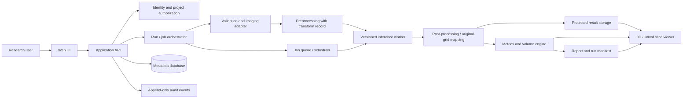

# NeuroScope 3D — Product Requirements Document

> **See a brain tumour in 3D, measure it, and know how far to trust it.**
>
> **Product direction:** A research-first medical-imaging platform with a deliberate path toward institutional research and, if supported by evidence and authorization, a potential clinical product.

| Document field | Value |
|---|---|
| Document | Product Requirements Document (PRD) |
| Product | NeuroScope 3D |
| Version | 2.0 — future-scope-led product definition |
| Date | 16 October 2026 |
| Status | Strategic baseline; assumptions and decisions requiring confirmation are marked **TBD** |
| Current release boundary | Research/teaching prototype using permitted public, de-identified data only |
| Long-term ambition | Research-lab platform, multi-site validation and possible regulated clinical workflow after separate gates |
| Primary clinical domain | Brain MRI research and glioma-region segmentation |
| Initial modality contract | T1, T1Gd/T1c, T2 and FLAIR; NIfTI first |
| Current stack | Proposed only; confirm against repository, model bundle and available compute |

> **Critical scope distinction:** This PRD describes the long-term product strategy, not permission to use the current prototype clinically. The initial build remains research-only. Real-patient data, clinical decision-making, clinical investigations and distribution as a medical device are separate activities that require their own institutional, privacy, security and regulatory review. A disclaimer alone does not make a medically intended product exempt from regulation.

---

## 0. How to use this PRD

This is the product source of truth for strategy, requirements, release sequencing and acceptance evidence. It should be read together with `Rules.md`, which defines engineering, security, data-handling and collaboration rules.

### Requirement language

- **MUST** — required before the applicable release gate can pass.
- **SHOULD** — expected unless a documented reason justifies deferral.
- **MAY** — optional capability or research direction.
- **P0 / P1 / P2** describe priority *within a release*, not whether a feature is allowed in every deployment stage.
- **R0 / R1 / R2 / R3 / R4 / R5** identify product maturity stages described in Section 6.
- **TBD** means the team needs a decision or evidence; it must not be represented as completed or confirmed.
- An item marked **future-gated** must remain disabled until its specified approvals, risk review and release criteria have passed.

### Evidence rule

A feature is not considered complete because a screen exists or an API returns HTTP 200. It is complete only when the expected behavior, failure behavior, test evidence, documentation and traceability are present. Model accuracy, clinical utility, regulatory status, security certification and time savings must never be claimed without appropriate evidence.

## 1. Executive summary

NeuroScope 3D is a browser-based platform for inspecting, measuring and evaluating 3D brain MRI segmentation. The initial workflow accepts four co-registered MRI sequences—T1, T1Gd/T1c, T2 and FLAIR—validates their data and spatial geometry, runs a documented 3D segmentation model, maps the result back to the source grid, and presents model-predicted tumour-related regions in an interactive 3D brain and synchronized axial, coronal and sagittal slices. The application calculates physical region volumes, optionally compares results with expert annotations, reports evaluation metrics when reference labels are available, and produces a reproducible provenance record.

The long-term product is larger than a single-case hackathon viewer. NeuroScope 3D is intended to evolve into a **research workflow platform**: case and cohort workspaces, dataset provenance, batch inference, experiment tracking, model/version registry, expert review, auditability, multi-site evaluation, secure institutional deployment and interoperable data import. If researchers and clinical partners establish a compelling intended use, the platform may later be assessed for an investigational clinical workflow and ultimately for a regulated clinical product. That pathway is conditional, jurisdiction-specific and evidence-led; it is not promised or assumed to be achievable simply by completing the software roadmap.

The product must make it possible to inspect both the segmentation and the evidence behind it. A convincing 3D mesh can still be wrong because of channel-order errors, image misalignment, left-right inversion, unsuitable scans, model-domain shift, incorrect label conversion or unjustified confidence. Spatial correctness, input quality, model provenance, reproducibility, uncertainty communication, privacy and safe failure are therefore core product features.

### 1.1 Product north star

**A research team should be able to reproduce a segmentation result, understand exactly how it was generated, inspect where it agrees or disagrees with reference labels, and decide whether the evidence is sufficient for its stated research purpose.**

### 1.2 Strategic outcomes

1. Turn single-case visualization into a reproducible imaging-analysis workflow.
2. Make AI segmentation outputs measurable, reviewable, comparable and traceable.
3. Support research teams running controlled experiments over permitted datasets and model versions.
4. Enable institutional research deployment with access control, audit, configurable retention and data governance.
5. Support independent, multi-site evidence generation before any clinical use is considered.
6. Keep clinical features and claims locked until a defined intended use, risk assessment, clinical evidence, quality controls and required authorizations support them.

## 2. Vision, mission and product positioning

### 2.1 Vision

Become a trusted research environment for 3D brain-MRI segmentation where visualization, quantitative measurement, model evaluation and provenance are delivered in one coherent workflow.

### 2.2 Mission

Help researchers and educators understand segmentation outputs spatially and quantitatively, while making the limitations of the data and model visible. Build the technical and governance foundations needed to investigate more consequential uses responsibly, without presenting a research prototype as a clinical device.

### 2.3 Product positioning

NeuroScope 3D is not intended to be merely:

- a static 3D brain demo;
- a generic file viewer without validated imaging geometry;
- a model API wrapper that cannot reproduce its own outputs;
- a report generator that hides missing evidence;
- a clinical diagnostic system at the current stage.

It is intended to bring together image ingestion, validation, versioned inference, spatial exploration, quantitative measurements, expert comparison, research operations and an auditable run record.

### 2.4 Differentiating product principles

1. **Geometry before graphics:** a beautiful rendering cannot compensate for incorrect orientation, spacing or affine mapping.
2. **Evidence before claims:** display what was measured, on which cases, using which method, and what remains unknown.
3. **Research reproducibility by design:** preserve model/configuration versions, input hashes, transforms, code revision and evaluation protocols.
4. **Human review stays visible:** model masks are model outputs, not ground truth. Expert annotations and reviewer edits must be distinguished.
5. **Safe failure is a feature:** unsupported inputs and unreliable processing must not result in a stale or plausible-looking false output.
6. **Privacy and governance are architectural concerns:** never bolt institutional security onto an unsegmented demo after sensitive data has already been introduced.
7. **Clinical translation is a gated lifecycle:** product ambition does not substitute for regulatory determination, scientific validation or authorization.

## 3. Problem statement and research hypothesis

### 3.1 Current workflow problem

A teaching or research case may include four MRI volumes, each containing many 2D slices. Understanding the overall shape, relationship between tumour core and surrounding oedema, physical volume, and anatomical side requires mentally combining the modalities and slice planes. Manual visual inspection alone offers no unified 3D representation, and volume estimates are difficult to reproduce consistently.

AI segmentation can create candidate voxel masks, but its outputs may be incorrect for reasons that are not apparent in a polished viewer: incompatible input modalities, incorrect channel ordering, invalid image geometry, anisotropic sampling, intensity differences between scanners, unsuitable images, incorrect model-output conversion, or domain shift. A single Dice score can also conceal clinically or scientifically important localized failures.

### 3.2 Product hypothesis

If researchers can view model-predicted tumour regions in 3D and linked orthogonal slices, inspect physical coordinates and region volumes, compare predictions with expert annotations, and retrieve the exact processing provenance, they can evaluate and discuss segmentation results more efficiently and reproducibly than with disconnected images and untracked model scripts.

This hypothesis must be tested using formative research with intended users. It is not a claim that the software improves diagnosis, clinical outcomes or patient safety.

### 3.3 Core questions the product must answer

- What data were supplied, and did the system verify that the inputs were usable and aligned?
- Which model, version, weights, configuration and preprocessing produced the output?
- What does each displayed region mean, and how was it derived from the model output?
- Where is the region in voxel and physical coordinates?
- How was estimated volume calculated?
- If expert labels exist, how does the prediction compare, and how were empty masks handled?
- What are the known limitations, failed checks and uncertainty indicators?
- Can another researcher reproduce this run from its record?
- Is this release authorized for this dataset, site, user and intended purpose?

## 4. Intended use by maturity stage

Intended use must be explicit and version-controlled. These contexts must not be treated as interchangeable.

| Stage | Permitted context | Data boundary | Claims boundary |
|---|---|---|---|
| **R0 — prototype / hackathon** | Demonstration, research and teaching | Public, de-identified research data only; challenge rules apply | No diagnosis or clinical decision use; no real-patient scans |
| **R1 — research-lab platform** | Institutional research and education under documented governance | Only datasets approved for the named purpose; permissions and retention rules recorded | Exploratory research results, not clinical recommendations |
| **R2 — research operations** | Cohort-level experiments, annotation review and reproducible model comparisons | Approved data access, controlled storage and role-based access | Research performance only; no clinical utility claims unless separately studied |
| **R3 — multi-site validation** | Independent site/cohort evaluation under agreed protocols | Site-specific governance, transfer or federated-processing permissions, de-identification controls | Evidence generation; no care-impacting use by default |
| **R4 — investigational clinical workflow** | Only within an approved/authorized study or explicitly permitted evaluation | Institution-approved environment, ethics/privacy approvals, required study/regulatory permissions | Investigational use only, per approved protocol and labeling |
| **R5 — potential clinical product** | A precisely defined clinical role after jurisdiction-specific clearance/authorization, where required | Production-grade health-data governance and contracts | Only claims supported by the authorized intended use and evidence |

The software MUST expose the current deployment stage in its configuration and documentation. R0 must be the default until the team has completed a formal stage-change review. A production deployment cannot become R4/R5 simply by changing a configuration flag or removing the disclaimer.

## 5. Users, stakeholders and permissions

### 5.1 Primary research users

| Persona | Responsibilities | Main needs |
|---|---|---|
| Imaging researcher | Runs model experiments and evaluates output | Repeatable inference, batch jobs, metrics, exports, provenance |
| Principal investigator / lab lead | Approves studies and oversees research outputs | Dataset access governance, project overview, audit records, experiment comparability |
| Expert annotator | Reviews or creates reference segmentation | Slice and 3D review, annotation versioning, disagreement review and adjudication |
| Research analyst / data manager | Curates cohorts, metadata and labels | Dataset manifest, integrity checks, exclusion reasons, reproducible split definitions |
| Educator / student | Learns segmentation concepts using permitted cases | Safe, understandable visualization and clear distinction between prediction/reference |
| Platform administrator | Operates institution deployment | User/org management, access policy, quotas, retention, monitoring and backups |

### 5.2 Future clinical-study stakeholders (future-gated)

| Persona | Additional needs |
|---|---|
| Clinical investigator | Approved protocol controls, locked model version, study traceability and adverse/failure reporting |
| Radiologist / intended professional user | Clearly specified intended use, limitations, review controls and workflow fit |
| Hospital IT / PACS administrator | DICOM compatibility, authentication, network boundaries, audit, maintenance and rollback |
| Privacy/security officer | Data-flow map, access logs, incident management, vendor/subprocessor inventory and deletion evidence |
| Quality/regulatory lead | Requirements traceability, risk file, controlled releases, verification/validation evidence and change records |
| Ethics committee / institutional review body | Study protocol, data use, consent/waiver basis, risks, handling and accountability, as applicable |

### 5.3 Role-based access model for R1+

At minimum, the product SHOULD support organization and project-scoped roles such as:

- **Platform administrator:** configures the installation and user access; does not automatically gain authorization to use every research dataset.
- **Project owner / PI:** manages a project, approved members, datasets and run access.
- **Researcher:** uploads permitted data, runs models and accesses authorized results.
- **Annotator/reviewer:** accesses assigned cases and creates versioned annotations where authorized.
- **Read-only reviewer/auditor:** views specified reports and audit evidence without altering data or configurations.

Authorization must be enforced on the server/API, not only by hiding interface controls. Organizations must be isolated from one another at the data, API and storage layers. The minimum R0 prototype may use a simpler local-user workflow, but its code should not assume all future users share one unrestricted workspace.

## 6. Product roadmap and release gates

Time estimates are planning assumptions, not delivery promises. Each stage is evidence-gated rather than calendar-gated.

### R0 — Proof of concept and challenge-compatible demonstrator

**Objective:** Prove that one supported case can flow end-to-end through validation, inference, correct-grid label output, 3D/slice review, volumes and report.

Scope:
- four NIfTI sequences with explicit mapping;
- input sanity and geometry checks;
- pretrained/eligible model inference;
- scorer-compatible output contract where the starter kit requires it;
- 3D brain and linked slices;
- WT/TC/ET region measurements;
- optional expert-mask comparison;
- model/data provenance and research-only messaging;
- failure pack and benchmark tests.

R0 constraints inherited from the challenge include public, de-identified data only, no external scan processing, file-size limits defined by the challenge, automatic deletion within 24 hours, and the two-minute T4-class target. These are R0/event constraints, not a universal retention rule for all future institutional installations.

### R1 — Single-lab research platform

**Objective:** Make individual cases, experiments and outputs organized, repeatable and reusable for a research group.

Planned capabilities:
- authentication and project workspaces;
- case registry with pseudonymous research identifiers and dataset manifests;
- versioned model registry and processing configurations;
- asynchronous job queue and per-job logs/timings;
- saved runs, outputs and report bundles under configurable institutional retention rules;
- user access controls and audit events;
- reproducible export/import of run manifests;
- batch inference for curated cohorts;
- annotation comparison and reviewer notes;
- lab-deployable packaging, health checks, backups and restore procedures.

Gate: security/privacy review; dataset-rights check; repeatability tests; user acceptance with research users; documented deployment and recovery instructions.

### R2 — Research operations and benchmarking

**Objective:** Support systematic, reproducible experiments over multiple cohorts and models.

Planned capabilities:
- dataset versioning and immutable cohort manifests;
- patient-level train/validation/test split manifests where permitted;
- model/configuration registry, experiment comparisons and controlled threshold selection;
- aggregate and per-case metrics; subgroup/site/scanner analysis when data permits;
- expert annotation versioning, inter-rater agreement and adjudication workflow;
- exportable analysis tables and report templates;
- reproducibility bundles including code revision, dependencies, model checksum and preprocessing configuration;
- permissioned cohort access and audit trail for data/export actions.

Gate: predefined evaluation plan; leakage controls; reproducible rerun; documented missingness/overlap; independent review of the analysis protocol.

### R3 — Multi-site research validation and interoperability

**Objective:** Establish whether results generalize beyond the source dataset and prepare for institution-controlled imaging systems.

Planned capabilities:
- DICOM import and conversion pipeline after validation of metadata and orientation;
- controlled DICOMweb/PACS integration in isolated test environments;
- optional FHIR metadata exchange where the institutional architecture needs it;
- site-specific configuration, access policies and local processing options;
- scanner/protocol/domain-shift analysis and quality warnings;
- de-identification/pseudonymization workflow and data-transfer manifests;
- centralized results with local image retention, or other governed multi-site designs if approved;
- site-level evaluation reports and data harmonization documentation.

Gate: site approvals and data agreements; documented DICOM conformance profile; external evaluation protocol; security review; independent site-level results.

### R4 — Investigational clinical workflow (future-gated)

**Objective:** Evaluate one explicitly defined potential clinical use in a controlled study without assuming general clinical readiness.

Prerequisites:
- written intended-use statement and target-user definition;
- jurisdiction-specific regulatory determination and required study permissions;
- institutional ethics/privacy approvals and data governance;
- locked model, preprocessing, thresholds, intended inputs and evaluation plan;
- formal hazard analysis and risk-control evidence;
- validated software lifecycle and quality processes appropriate to the study;
- secure site-controlled deployment, incident/failure handling and study monitoring;
- pre-specified endpoints and analysis plan;
- human-factors/workflow evaluation and a clear fallback to standard care/workflow.

The system MUST NOT influence patient care outside the approved/authorized conditions of the study. A retrospective test or silent-mode study does not automatically establish clinical benefit or authorization for active clinical use.

### R5 — Potential regulated clinical product (future-gated)

**Objective:** Consider distribution or use in a defined care workflow only after required evidence and authorizations are in place.

This stage requires its own product version, intended-use statement, clinical performance requirements, risk-management file, quality-system plan, cybersecurity programme, usability evidence, deployment/maintenance process, post-deployment monitoring and regulatory submissions as applicable. The scope and evidence depend on the chosen jurisdiction, intended purpose, output, user, and clinical consequences. No universal regulatory classification is assigned by this PRD.

### Roadmap rule

Do not implement every future feature in R0. Build a small but modular product: implement the current case workflow well, keep imaging/inference/storage/reporting boundaries clean, and add research operations only when the previous release has test evidence and a real user need.

## 7. Goals, exclusions and measurable outcomes

### 7.1 Product goals

- **G1 — Correct spatial results:** every valid prediction and overlay is tied to verified image geometry.
- **G2 — Reproducibility:** the same inputs, model revision and configuration can be rerun and compared.
- **G3 — Research usefulness:** users can manage cases/experiments as a research workflow rather than a one-off upload.
- **G4 — Evidence transparency:** reports separate observed metrics, estimates, quality warnings, uncertainty and missing evidence.
- **G5 — Institutional readiness:** later releases can be operated under a lab's data-access, identity, retention and audit policies.
- **G6 — Responsible future development:** any clinical direction is supported by evidence, risk controls and a regulator/institution-reviewed intended use.

### 7.2 Explicit exclusions unless later approved

- diagnosis, glioma grading, molecular classification, genetic prediction, prognosis or treatment advice;
- autonomous clinical decisions or claims of replacing radiologists;
- surgical or radiotherapy planning;
- generalization to other organs, diseases, modalities or sequences without separate model validation;
- automatic model retraining from user edits without reviewed data governance, consent/permissions, curation and validation;
- unreviewed continuous model updates in clinical or investigational settings;
- unapproved uploads of identifiable, private or real-patient images in R0;
- claims of clinical accuracy, patient outcome improvement, regulatory approval or certification without evidence;
- automated PACS write-back or report insertion before integration, safety, security and workflow validation.

## 8. Key user journeys

### 8.1 Single-case research inspection

1. User selects a research project or opens the local R0 tool.
2. User supplies four sequences and explicitly confirms sequence mapping.
3. The system validates NIfTI integrity, data values, geometry and supported inputs.
4. The system shows validation summary and any warnings before inference.
5. User runs a versioned model configuration.
6. The result opens in the 3D and linked-slice workspace.
7. User inspects WT/TC/ET, world coordinates, estimated volume and optional expert comparison.
8. The user exports a result bundle and report with all relevant provenance.

### 8.2 Research experiment over a cohort (R1/R2)

1. Researcher creates a project and attaches a data manifest for a permitted cohort.
2. Project owner records dataset source, license/terms, permissions, pseudonymization and exclusion criteria.
3. Researcher chooses a versioned model/configuration and a patient-level cohort split.
4. System validates input manifests and schedules asynchronous jobs within the available compute quota.
5. Runs are associated with immutable input hashes, model revision, configuration and status.
6. Researcher reviews aggregate metrics plus per-case failures and subgroup/site performance where available.
7. Another authorized member re-runs or inspects the analysis from its recorded manifest.
8. The project exports a reproducibility package without exposing data beyond authorized scope.

### 8.3 Expert annotation and adjudication (R1/R2)

1. Reviewer opens an assigned case and clearly sees whether each overlay is prediction, initial annotation or adjudicated reference.
2. Annotation/editing occurs in a separate version, never overwriting the original input or model output.
3. Every annotation revision records author, timestamp, version and reason/comment where required by the study protocol.
4. Disagreements can be flagged for adjudication; inter-rater metrics can be computed where the protocol supports them.
5. Model metrics identify exactly which reference version was used.

### 8.4 Institutional data import (R3)

1. An authorized institution configures a connection in a controlled environment.
2. DICOM selection is limited to the approved study and required series.
3. The import pipeline verifies series completeness, modality, orientation, spacing and patient/study linkage as permitted.
4. De-identification or pseudonymization follows institutional policy and records a transformation manifest.
5. Image data stay within the configured approved boundary; no external service receives the images without explicit approval and contractual/legal basis.
6. The researcher reviews the import and validation report before running inference.

### 8.5 Clinical investigation (R4, future-gated)

The application only accepts study cases from an approved study workflow, verifies the locked model and protocol version, logs the case/run in a study record, and handles failures according to the approved protocol. Results must be labeled according to study authorization and must not be routed into routine care unless that activity is separately authorized. Study staff must have a documented standard workflow when the software is unavailable or the input is unsupported.

## 9. Functional requirements — core imaging and inference

These requirements define the technical foundation that all later releases must preserve. R0 implementations may use the simpler local deployment, but the contracts and tests should be stable enough to extend.

### FR-001 — Intended-use banner and release context

**Priority:** MUST in every release. The UI and generated reports must display the current deployment stage and appropriate use statement. R0/R1/R2 wording must say that model outputs are for research/teaching and are not intended for diagnosis or clinical decision-making. R4/R5 wording can only be approved through the relevant governance and regulatory process; it must not be a simple copy edit.

**Acceptance:** the banner appears on upload, validation, processing, results, errors and reports; build/configuration cannot falsely declare clinical authorization; any stage change requires release approval.

### FR-002 — Four-sequence ingestion and modality mapping

**R0 input contract:** four 3D NIfTI files (`.nii` or `.nii.gz`) representing T1, T1Gd/T1c, T2 and FLAIR. Filename inference can suggest mappings but users must confirm them.

**R1+ design direction:** ingest files through a format-adapter boundary so NIfTI remains supported while a DICOM adapter can be added later without rewriting the inference core.

**Acceptance:** each modality mapped exactly once; missing/duplicate modalities blocked; mapping visible in run record; file metadata displayed; model order is applied separately from upload order.

### FR-003 — File and image validation

Validate actual file contents, not only extension/MIME type. Check readability, gzip integrity, dimensions, numeric finiteness, constant volumes, supported datatype, size limits, positive voxel spacing, affine validity, shape/affine agreement and unsupported dimensions. Clearly distinguish a hard rejection from a quality warning.

R0 must cover the event failure pack: false NIfTI extension, corrupt gzip, missing sequence, shape mismatch, 2D input, all-zero/constant input, NaN/Inf and over-limit input. Clearly warn/refuse if the case is not a supported skull-stripped brain MRI. Image-suitability heuristics must not be described as a guaranteed anatomical classifier.

R1+ should add configurable quotas, decompression bomb defenses, queue limits and institutional policies. The maximum size must be configurable by deployment and model memory budget; the challenge's per-file size limit is an R0-specific setting, not necessarily a permanent product limit.

### FR-004 — Geometry integrity and provenance

Record dimensions, spacing, affine, qform/sform codes and relevant metadata. Matching array shape is not sufficient to prove alignment. If affine/qform/sform information conflicts materially, the system must warn or reject rather than guess. The chosen reference grid and affine must be explicit in every run.

Any resampling/cropping/orientation transforms must be stored in a transform record and inverted or otherwise mapped back through a deterministic, tested process. Categorical masks require nearest-neighbour interpolation when resampled.

### FR-005 — Model inference and output map

Run a versioned eligible model using its documented input order and preprocessing, then write the prediction on the original reference grid and affine. Model weights, configuration, preprocessing and post-processing are immutable for each recorded run.

If the selected model produces nested regions WT, TC and ET rather than component labels, convert them deliberately:
- derive ED as `WT \ TC`;
- derive NCR as `TC \ ET`;
- retain ET as the enhancing component;
- enforce/document `ET ⊆ TC ⊆ WT` using a deterministic policy applied to thresholds/probabilities;
- write BraTS component codes: background `0`, NCR `1`, ED `2`, ET `4`.

The exact hierarchy-reconciliation policy and output tensor semantics must be tested against the selected bundle. A mask that only contains WT/TC/ET codes is not automatically a valid BraTS component label map. The report must disclose any conversion and its known limits.

**Acceptance:** NIfTI output reloads successfully, includes only valid codes, matches reference dimensions/affine, works with the intended scorer/consumer, and can be produced by a documented CLI/API without a browser.

### FR-006 — Segmentation model registry

R1+ MUST record each model as an immutable entity with model ID, architecture, source, version/checksum, license, weights source, training-data description, supported inputs, channel order, preprocessing, output definitions, thresholds, known limitations, evaluation summaries and approval status for each deployment stage.

A new model version must not replace a previous version silently. Existing runs must remain linked to the exact model/configuration used. R0 may store a simple static model manifest, but that manifest must be sufficiently complete to populate the report/model card.

### FR-007 — 3D visualization

Provide rotatable/zoomable 3D view, region visibility toggles, opacity, reset-camera control, legend and distinct styling for prediction, expert reference and uncertainty/disagreement where available. Meshes must be generated from the current case, positioned in physical/world coordinates, and must never be the source of truth for voxel count or volume.

A mesh-generation failure should not invalidate a valid NIfTI prediction or slice viewer; show a clear failure and allow other validated result views to remain available.

### FR-008 — Linked orthogonal slices and coordinates

Display axial, coronal and sagittal slices with overlays and explicit orientation labels. One crosshair links all views and a 3D marker. Show voxel indices and world coordinates in millimetres. Orientation must derive from the affine, not from assumed array-axis order. Test left/right flips and known-marker fixtures. Document index rounding, voxel-centre policy and out-of-bounds behavior.

### FR-009 — Quantitative volumes

For each region, show voxel count, voxel-volume scale, formula and estimated mL. Calculate volume from the output voxel mask and image affine—not mesh triangle volume.

`voxel_volume_mm3 = abs(det(affine[0:3, 0:3]))`

`estimated_volume_mL = voxel_count × voxel_volume_mm3 / 1000`

Label results as **estimated volume of the model-predicted region** in research releases. For orthogonal grids this is equivalent to the product of voxel spacing magnitudes divided by 1000 after multiplying by voxel count. Display rounding must not alter internal precision.

### FR-010 — Expert-mask comparison

Accept a reference mask in the dataset's documented label convention, validate its grid and labels, and distinguish it from the prediction. Where required, use documented nearest-neighbour resampling or refuse an incompatible grid; never silently overlay misaligned masks. Store reference-mask version and hash with metric results.

Only calculate Dice/sensitivity/HD95 when a valid reference is present. Explain that metrics represent agreement with the supplied reference under a particular protocol, not guaranteed clinical correctness.

### FR-011 — Model evaluation

Support per-case and aggregate Dice and sensitivity for WT/TC/ET, with optional HD95 and volume error. Evaluation protocols must record dataset version, patient-level split, excluded cases, label/annotation version, metrics implementation, empty-mask policy, thresholds and model revision.

R0 retains the challenge's minimum 10 held-out labelled cases and split/training-overlap disclosure if those cases are supplied. R1+ must not treat this small prototype evaluation as sufficient evidence for generalization: formal studies need sample-size/statistical plans and data representative of their stated research question.

### FR-012 — Uncertainty and quality indicators

Uncertainty MAY be computed via test-time augmentation or an ensemble, provided the method is documented and runtime is measured. Prediction disagreement, uncertainty, data-quality flags and expert disagreement must use distinct labels. Raw model scores must not be called calibrated probabilities without calibration evidence.

Quality indicators should cover unsupported/missing sequences, geometry concerns, intensity anomalies, poor model support and known out-of-distribution limits when a validated method exists. Every warning must state whether it blocks processing or merely flags risk.

### FR-013 — Reproducible run manifest

Every successful run must capture:
- run ID and timestamps;
- input file hashes and modality mapping;
- data/subject pseudonymous key where governance permits (never raw patient identifiers by default);
- dimensions, voxel spacing, affine summary and validation result;
- model ID, weights checksum and configuration;
- preprocessing and inverse-transform record;
- post-processing/threshold/hierarchy policy;
- source-code commit/container image/dependency lock version;
- runtime hardware and stage timings;
- output mask hash, label validation result and grid/affine;
- derived region counts/volumes and comparison metrics with reference ID;
- quality warnings, job status and report location.

Any value that is unavailable must be explicitly marked “not recorded” or “unknown”; never fabricate provenance. Input hashes are integrity identifiers, not proof that data are de-identified or permitted for use.

### FR-014 — Reports and exports

Generate an HTML/PDF report and structured JSON manifest. Include intended-use banner, model/data provenance, volume method, metrics protocol and values if available, warning status, limitations and citations. Reports must distinguish observed measurements, model outputs, derived estimates and expert-reference values.

R1+ should support a reproducibility bundle containing report, manifest, prediction NIfTI, optional mesh/visualization assets, evaluation output, checksums and a README describing the execution environment. Export must obey project permissions and data-use agreements.

### FR-015 — Job state, failure and retry

Use explicit states: created, uploading, validating, rejected, queued, preprocessing, inference, post-processing, meshing, metrics/reporting, succeeded, failed, cancelled and expired. Expose progress only when meaningful. A failed or retried job must not accidentally reuse a previous case's mask/result. Errors require stable codes, actionable messages and safe logs.

### FR-016 — Research project/workspace (R1)

Create project workspaces with purpose, owner, members, approved datasets, model versions, study protocol/reference links, retention policy, exports and audit events. Server-side authorization is required. Projects must isolate data and runs; cross-project sharing must be explicit and audited.

### FR-017 — Dataset and cohort registry (R1/R2)

Store dataset manifests, source/citation, license/terms, date accessed, data version, permitted purpose, de-identification status, modality availability, inclusion/exclusion criteria, split membership and label provenance. The registry should refer to files through controlled storage identifiers rather than duplicating large datasets by default.

Cohort operations must use stable pseudonymous research identifiers and avoid joining or exporting identity mappings without explicit authorization. Cohort changes must create a new version instead of silently changing a prior analysis set.

### FR-018 — Batch inference and experiment tracking (R1/R2)

Support queued batch jobs with per-case status, retry policy, compute limits, summaries, model/configuration pinning and exportable results. Experiment comparisons must record all parameter and cohort changes. Cancelled/failed cases must be visible in the denominator and not quietly disappear from aggregate reporting.

### FR-019 — Annotation workflow (R1/R2)

Support imported annotations first; collaborative editing may be added after controls are defined. Annotations must be versioned, attributable, linked to a grid and case, and distinguish original, edited and adjudicated states. Reviewer edits must never silently overwrite the raw prediction or original expert mask. Metrics must identify which annotation version was used.

### FR-020 — Identity, audit and administration (R1+)

Support authenticated users, project-level roles, session controls, least privilege, account revocation, audit events and administrator operations. Record security-relevant events (login, permission changes, access/export, model release, deletion, configuration changes) with timestamps and actor IDs. Audit logs must not contain raw image voxels or unnecessary patient details.

### FR-021 — Multi-site research support (R3)

Support site metadata, separate site-level performance summaries and configured deployment boundaries. The architecture may support federated workflows or local processing with aggregated results, but neither should be advertised as implemented until data flows, security and statistical assumptions are tested. Never pool or transfer site data without the documented permissions and agreement.

### FR-022 — DICOM and institutional interoperability (R3)

Add DICOM ingestion through a dedicated adapter. Validate series selection, orientation, spacing, slice consistency, modality and metadata. Define a DICOM conformance statement for the actual operations implemented. DICOMweb (QIDO-RS, WADO-RS, STOW-RS) and FHIR `ImagingStudy`/`DiagnosticReport` integration are optional integration directions, not guaranteed compatibility claims.

Initial PACS integration must be read-only and tested in a sandbox. Automatic write-back of masks/reports is future-gated until supported storage objects, routing, permissions, provenance, rollback and workflow hazards have been evaluated.

### FR-023 — Clinical study controls (R4, future-gated)

If authorized for a clinical investigation, enforce approved protocol/model versions, study-specific accounts and logs, data handling rules, permitted outputs, pre-specified endpoints, failure escalation and auditability. Disable unapproved uses and exports. Do not activate this requirement based only on a project administrator's toggle; it requires a documented governance/release decision.

### FR-024 — Clinical deployment controls (R5, future-gated)

Potential clinical deployment requires a separate signed-off intended-use statement, applicable regulatory authorization, validated release, model and software change control, user training/instructions, cybersecurity and maintenance processes, clinical performance evidence and post-deployment monitoring. This requirement is a roadmap gate, not a claim that such capabilities currently exist.

## 10. Research and clinical data governance

### 10.1 Data categories

| Category | R0 | R1/R2 | R3/R4/R5 |
|---|---|---|---|
| Public, de-identified research images | Allowed if dataset/event terms permit | Allowed under dataset/project terms | Allowed under project/site terms |
| Private institutional research images | Not allowed | Only with institutional approval, legal basis, agreement and approved deployment | Only within the applicable approved protocol/deployment boundary |
| Identifiable patient images | Not allowed | Not enabled by default; requires separate governance/security determination | Only if explicitly permitted and necessary for the approved use, with required safeguards |
| Hidden judge cases | Never train/tune/retain/look up; obey event deletion rules | Not applicable | Not applicable |
| User-submitted external data | Not allowed unless covered by R0 rules | Allowed only after permission and policy checks | Allowed only according to authorized intended use and controls |

### 10.2 Data lineage

Every dataset or imported case should record source, license/terms, date/access mechanism, modality, preprocessing history, annotations and exclusions. The platform should support a data dictionary and codebook for research variables. Store consent/ethics/contract metadata as references or status fields without exposing confidential documentation to unauthorized users.

### 10.3 Retention is deployment-specific

- **R0:** delete uploaded files and temporary derivatives automatically within 24 hours, as required by the challenge. Do not loosen this rule for convenience.
- **R1/R2:** retention can be configured only according to an institution-approved retention schedule, dataset license, research protocol and applicable law. The system must support retention expiry, deletion logs and handling of backups/cache where feasible.
- **R3/R4/R5:** retention and archival must follow the approved site/study/regulatory requirements. The platform must not invent a universal retention period. Deletion may be subject to legal holds or validated study records; define the rule with the institution and counsel.

### 10.4 Privacy by design

Use minimum necessary data, pseudonymous IDs, separate identity keys where applicable, role-based access, scoped exports and privacy-aware logs. De-identification reduces risk but does not guarantee that re-identification is impossible. MRI headers, filenames, facial anatomy in some imaging, linked metadata and institutional identifiers require attention. The workflow must clearly state which fields and content are preserved, removed or transformed.

### 10.5 Data rights and research ethics

Before a dataset is attached to an R1+ project, record whether its terms permit research, derivative masks, model training/fine-tuning, publication, commercial use if relevant, and data redistribution. These permissions are separate questions. Institutional human-research review, consent or waiver, data-sharing agreements and other approvals depend on the data and study; the platform must not infer approval merely from a dataset upload.

## 11. Non-functional requirements

These targets are layered. Numeric targets must be refined using actual user, compute and institution requirements instead of presumed to fit every future use.

| ID | Attribute | R0 baseline | R1/R2 research platform | R3+ / future-gated |
|---|---|---|---|---|
| NFR-001 | Correctness | Correct label codes, grid, affine and region math | Repeatable runs, immutable manifests, cohort integrity | Verified integration and intended-use performance |
| NFR-002 | Reliability | No crash on failure-pack tests | Job recovery, queue limits, retry and failure visibility | Defined service/continuity targets agreed with site |
| NFR-003 | Security | Controlled local environment, no external scan APIs | Auth, least privilege, audit, encryption and dependency management | Institution-approved threat model, incident response, backup/restore and formal review |
| NFR-004 | Privacy | Public/de-identified data only; cleanup within 24 h | Purpose limitation, configurable retention and export controls | Approved data boundary, governance and breach handling |
| NFR-005 | Performance | Two-minute case target on organizer T4-class GPU | Batch throughput, queue latency and memory benchmark | Site-specific workload/SLA proven under intended conditions |
| NFR-006 | Reproducibility | Same-case outputs Dice ≥0.99 if required by scorer | Re-run manifest, version pinning and environment lock | Controlled release and model-change evidence |
| NFR-007 | Traceability | Model, preprocessing, input hashes, commit and timestamp | Data/model/run registries and audit trail | Quality records, controlled release and post-deployment monitoring |
| NFR-008 | Usability | Clear single-case workflow | Role-based workflows, reviewer usability and batch feedback | Human-factors evidence for any safety-relevant intended use |
| NFR-009 | Interoperability | NIfTI input/output | Stable versioned API and metadata manifests | DICOM/FHIR/PACS conformance verified per implementation |
| NFR-010 | Maintainability | Modular source and reproducible setup | CI, migrations, dependency pinning and runbooks | Software lifecycle controls and documented change impact |
| NFR-011 | Accessibility | Contrast, labels, keyboard focus | Usability testing with intended research roles | Safety-related use-error assessment where applicable |
| NFR-012 | Scalability | One case / bounded worker | Bounded parallel batch processing and quota system | Site load and resilience proven before deployment claims |
| NFR-013 | Portability | Documented local command | Containerized lab deployment and environment config | Reproducible installation, upgrade and rollback for approved sites |

## 12. Technical architecture and design principles

### 12.1 Recommended initial architecture

Begin with a **modular monolith plus a separated inference worker** rather than premature microservices. Keep module boundaries clean, interfaces versioned and persistent-state abstractions explicit. Split services only when throughput, multi-tenancy, security boundaries or operational needs justify it.



### 12.2 Suggested modules

- `frontend/`: upload, case workspace, 3D/slice viewers, experiments, dataset registry, report views.
- `api/`: schema validation, authentication integration, versioned endpoints, authorization and structured errors.
- `projects/`: projects, users, permissions and study metadata.
- `datasets/`: manifests, file inventory, labels, cohort versions and provenance.
- `imaging/`: NIfTI/DICOM adapters, image headers, geometry and transforms.
- `validation/`: file content, numeric, geometry, input-quality and modality checks.
- `preprocessing/`: model-specific transforms defined by pinned configuration.
- `inference/`: model registry, device selection, loading, worker and job orchestration.
- `segmentation/`: thresholds, nested-region reconciliation and output label-map contract.
- `geometry/`: affine transforms, voxel/world conversion, mesh space and orientation utilities.
- `metrics/`: region volumes, Dice, sensitivity, HD95, volume error and aggregate policies.
- `experiments/`: run comparison, cohort splits, parameters and aggregate analyses.
- `annotations/`: reference mask and review versions.
- `reporting/`: HTML/PDF, structured manifest and reproducibility bundle.
- `storage/`: temporary workspace, controlled object store and retention/deletion jobs.
- `audit/`: security events and data access/export trails.
- `tests/`: unit, integration, validation pack, geometry, scorer, reproducibility, performance and security checks.

### 12.3 Recommended technology choices (provisional)

| Layer | Candidate | Decision guidance |
|---|---|---|
| Frontend | React + TypeScript | Useful for complex research workspace and typed viewer state |
| 2D medical viewer | NiiVue or another geometry-aware library | Prove orientation/crosshair behavior with NIfTI fixtures before committing |
| 3D meshes | Three.js / React Three Fiber | Use image affine and physical spacing correctly; mesh is display only |
| API | Python + FastAPI | Direct integration with Python imaging/ML stack |
| Image I/O | NiBabel; SimpleITK where needed | Verify affine, qform/sform, spacing and resampling semantics |
| AI | MONAI and a verified model bundle | Pin bundle revision and output semantics; do not assume model license/training data |
| Numerical metrics | NumPy and tested metric code | Match organizer scorer for R0 and predefine research analysis later |
| Queue | Redis/RQ, Celery or institutional scheduler | Choose after load and operational needs are known |
| Metadata database | PostgreSQL for R1+ | Store metadata and relationships, not large voxel arrays by default |
| Object/file storage | Local protected storage or institution-approved object store | Must support access isolation, checksums, expiry and deletion policy |
| Packaging | Docker/OCI image where deployment policy permits | Pin dependencies; include hardware/runtime assumptions |
| Observability | Structured logs and stage metrics | Never record raw images or excessive identifying metadata in logs |

These are candidates, not confirmed installed dependencies. Exact versions, licences, deployment patterns and compatibility must be tested before adoption.

### 12.4 Deployment models

The product should consider three future deployment profiles:

1. **Developer/demo:** local laptop and public datasets; minimal services; no patient data.
2. **Research institution:** on-premises or institution-approved private environment, institution identity where possible, controlled storage, local GPU/compute, project-level access and retention policy.
3. **Multi-site / regulated environment:** site-specific security boundary, controlled integration, formal release management, detailed operational monitoring and approved data-transfer or federated analysis protocols.

Cloud hosting is not automatically suitable for institutional or patient information. Hosting, subprocessors, data residency, backups, support access and cross-border transfer must be reviewed for each deployment.

## 13. Storage model and core entities

A future-ready metadata schema should include the following entities. The initial prototype can implement a small subset, but should avoid key design assumptions that block future versioning.

| Entity | Purpose | Important fields |
|---|---|---|
| Organization | Tenant/security boundary | ID, name, deployment policy, retention defaults |
| User / Role | Identity and permissions | User ID, organization, roles, status, last login |
| Project / Study | Research workspace | Project ID, purpose, owner, protocol reference, permissions, status |
| Dataset | Source and permission manifest | Dataset ID/version, citation, terms/license, allowed purpose, access date |
| Case | Pseudonymous research case | Case ID, dataset ID/version, site metadata, sequence inventory |
| Imaging asset | Stored file metadata | Storage key, checksum, modality, dimensions, affine, expiry/retention class |
| Annotation | Reference or reviewer mask | Annotation ID/version, author/role, source, label schema, adjudication state |
| Model version | Immutable model identity | Model ID/version, checksum, license, training/source description, status |
| Inference configuration | Reproducible processing recipe | Preprocess, thresholds, postprocess, channel order, code/container version |
| Run / Job | Execution record | Run ID, input IDs/hashes, model/config, state, timings, warnings, outputs |
| Metric result | Quantitative comparison | Metric name, region, prediction, reference version, protocol, values |
| Report / Export | Deliverable record | Version, generated time, content hash, export actor, access policy |
| Audit event | Accountability | Actor, event, object, time, result, minimal metadata |

The schema must never assume a case identifier is the patient identifier. Linking to identifiable records, if ever necessary, belongs in an institution-governed system with separately controlled access—not in a generic demo table.

## 14. API and integration strategy

APIs must be versioned and must implement the same validation, preprocessing and inference logic used by the UI.

### 14.1 Initial API proposal

- `POST /api/v1/validate` — validate four mapped sequences and optional reference mask.
- `POST /api/v1/runs` — create a run using a named model/configuration and authorized project/case.
- `GET /api/v1/runs/{run_id}` — status, progress/stage and result summary.
- `GET /api/v1/runs/{run_id}/prediction` — download the predicted label map if authorized.
- `GET /api/v1/runs/{run_id}/report` — download report and manifest if authorized.
- `GET /api/v1/models` — list models available to the user's stage/project.
- `GET /api/v1/projects/{project_id}/runs` — list authorized runs for R1+.

Exact payload schemas should be recorded as OpenAPI. Large inputs should use streaming or controlled upload handling; long inference should use asynchronous job IDs rather than relying on fragile HTTP timeouts.

### 14.2 Error contract

Use structured, stable errors with codes and actionable messages. For example:

```json
{
  "error": {
    "code": "AFFINE_MISMATCH",
    "message": "The T2 volume is not aligned with the selected reference volume.",
    "action": "Confirm that all sequences belong to the same co-registered research study.",
    "run_id": null
  }
}
```

Do not include raw image content, credentials, secrets or uncontrolled absolute paths in API errors. A rejected request must not generate an apparently successful report.

### 14.3 Future interoperability

- **DICOM/DICOMweb:** consider query/retrieve/store operations only after the actual conformance profile and image-selection behavior are specified. Initial institutional integration SHOULD be read-only.
- **FHIR:** `ImagingStudy` and `DiagnosticReport` may be relevant for exchanging imaging/report metadata in systems that use FHIR; the exact profile and workflow are institution-specific.
- **PACS/RIS/HIS:** no generic “PACS compatible” claim without testing against named systems, supported transfer syntax, auth, metadata mapping and failure/rollback behavior.
- **Research exports:** CSV/JSON/Parquet or similar formats can be considered for aggregate tables, subject to privacy, license and project permission checks.

## 15. User experience and interface requirements

### 15.1 Design direction

Use a calm scientific-workstation aesthetic: restrained colours, high contrast, readable labels, clear legends and consistent status semantics. The interface must not use colours or animated effects that imply a level of certainty unsupported by evidence. Keep prediction, reference, disagreement, uncertainty and warnings visually distinct. Do not make colour the only means of understanding an overlay.

### 15.2 Core screens

1. **Workspace/projects (R1+):** active project, permissions, dataset status, recent runs and warnings.
2. **Upload/import:** sequence mapping, modality metadata, file checks, dataset provenance and retention notice.
3. **Validation summary:** checks passed, warnings, failures, geometry information and whether the case may proceed.
4. **Processing/jobs:** current stage, queue status, elapsed time, per-stage progress where available and retry/cancel actions.
5. **Case workspace:** central 3D view, axial/coronal/sagittal panels, synchronized crosshair, voxel/world coordinates, region toggles, volumes, optional expert comparison and provenance panel.
6. **Experiment/cohort view (R1/R2):** selected dataset and cohort version, model/config version, run status, aggregate metrics and per-case failures.
7. **Annotation review (R1/R2):** annotation source/version, reviewer actions, disagreement and adjudication status.
8. **Report/reproducibility:** result summary, formulas, evaluation method, provenance, limitations, downloadable manifest and authorized exports.
9. **Administration (R1+):** users, projects, policies, quotas, retention, job health and audit search with permissions.

### 15.3 Required view semantics

The UI must clearly identify:
- model prediction versus expert annotation;
- derived WT/TC/ET regions versus component label codes;
- estimated volumes versus ground-truth/reference volumes;
- metric results versus uncertainty indicators;
- validation failure versus non-blocking quality warning;
- a completed run versus a stale, partial or failed result;
- the model/version used and the permitted intended-use stage.

### 15.4 User-centered validation

R1 should run formative sessions with researchers/educators to see whether they can map sequences correctly, find a region in all views, interpret volume math, distinguish prediction/reference, understand warnings and retrieve provenance. R4+ requires formal human-factors/usability work suited to the safety risks and intended user population.

## 16. AI/ML lifecycle and scientific governance

### 16.1 Model onboarding checklist

Before a model can be enabled, record:
- architecture, source URL and exact version/weight checksum;
- license and redistribution/derivative restrictions;
- date publicly available when event rules require it;
- training data and known overlap/uncertainty;
- intended task and supported population/data conditions;
- required modalities, order, spacing, orientation, normalization and crop/pad;
- output tensor/channel semantics and thresholds;
- post-processing and hierarchy enforcement;
- runtime and memory profile;
- known limitations/failure cases;
- benchmark results under a documented split and metric implementation;
- stage approvals (R0, R1, R2, etc.) and owner.

### 16.2 Dataset and split governance

- Split at the patient level, never at slice/patch level when these derive from the same subject.
- Keep training/fine-tuning, development/model-selection, internal test and external validation roles distinct.
- Record dataset version, inclusion/exclusion rules, missing modalities and preprocessing.
- Record annotation origin and inter-rater variability where available.
- Disclose possible overlap with pretraining data; “unknown” is a valid state when it cannot be established, but it must not be hidden.
- Do not use hidden benchmark/test cases for training, tuning, data lookup or retention where prohibited.
- Avoid using a single public dataset as evidence of generalization across sites and scanners.

### 16.3 Evaluation layers

1. **Technical validation:** does the pipeline correctly read, transform, label, save and reproduce data?
2. **Analytical validation:** does the software produce accurate, reliable, precise numerical outputs for defined inputs and known references?
3. **Research validation:** does the model perform on the stated research cohorts under a predefined protocol?
4. **External validation:** are results consistent on independent sites/scanners/populations relevant to the research claim?
5. **Clinical validation, if relevant:** does the output have a valid clinical association and perform as intended for a precisely defined clinical purpose?
6. **Clinical utility / workflow evaluation, if claimed:** does use in the defined workflow improve a prespecified meaningful outcome without unacceptable risk?

These levels answer different questions and cannot be collapsed into a single Dice score.

### 16.4 Monitoring and model change control (R2+; clinical versions future-gated)

Record changes to model weights, threshold, transforms, libraries, GPU/runtime, label mapping and input support. Each change triggers an impact assessment and relevant regression suite. A previous approved version must remain identifiable and restorable. In a clinical pathway, model updates must follow the authorized change-management plan; online/self-updating behavior is prohibited unless specifically assessed and authorized.

## 17. Quantitative definitions

### 17.1 BraTS 2021 component codes

| Code | Component |
|---:|---|
| `0` | Background |
| `1` | NCR — necrotic/non-enhancing tumour core component |
| `2` | ED — oedema |
| `4` | ET — enhancing tumour component |

Derived masks:

| Region | Definition |
|---|---|
| WT — whole tumour | `NCR ∪ ED ∪ ET` |
| TC — tumour core | `NCR ∪ ET` |
| ET — enhancing tumour | `ET` |

The regions are nested; they are not three mutually exclusive labels. Exact descriptions must match the specific dataset/model documentation used.

### 17.2 Volumes

For region mask `M` and voxel-to-world affine `A`:

`voxel_count = count_nonzero(M)`

`voxel_volume_mm3 = abs(det(A[0:3, 0:3]))`

`estimated_volume_mL = voxel_count × voxel_volume_mm3 / 1000`

Use the original-grid voxel mask as the source of truth. The affine determinant supports axis flips/rotations and is preferable to assuming a particular axis order. Confirm the affine is valid and physical units are interpreted correctly.

### 17.3 Dice and sensitivity

For binary prediction `P` and reference `G`:

`Dice = 2 × |P ∩ G| / (|P| + |G|)`

`Sensitivity = |P ∩ G| / |G|`

Document the empty-mask policy and match the organizer scorer for R0. For research studies, predefine how metrics are aggregated across cases (macro average, pooled voxels, confidence intervals and subgroup analysis as appropriate). Do not switch aggregation after observing results without disclosure.

### 17.4 Uncertainty

TTA/ensemble disagreement can be a useful uncertainty proxy but is not automatically a calibrated probability or a guarantee of error. If displayed, report method, number of passes/models, transformation policy and validation evidence. Evaluate whether uncertainty correlates with actual error on a suitable reference cohort before making stronger claims.

## 18. Validation, verification and testing strategy

### 18.1 Test layers

- **Unit:** labels, region nesting, volume math, metric empty-mask policy, affine conversions, hashing and retention timestamps.
- **Integration:** upload → validation → preprocessing → inference → inverse transform → NIfTI write → report.
- **Golden-fixture geometry tests:** known orientations, same anatomy with updated affine, true mirrored anatomy, anisotropic spacing and marker coordinate alignment.
- **Failure-pack tests:** malformed extension, corrupt gzip, incomplete sequences, shape mismatch, 2D, constant/zero, NaN/Inf, size over limit and unsupported brain/stripping conditions.
- **Reproducibility tests:** same input/configuration, recorded model and dependency revision.
- **Performance tests:** stage timing, GPU VRAM, large cases, cold/warm start and queue concurrency.
- **Security tests:** authentication/authorization, tenant/project isolation, path traversal, malformed files, resource exhaustion, dependency vulnerabilities and export permissions.
- **Usability tests:** intended users complete tasks and correctly interpret state, labels, units, warnings and disclaimers.
- **Research validity tests:** patient-level splits, independent cohorts, data provenance, statistical plan and failure analysis.
- **Clinical verification/validation (future-gated):** protocol-specific technical, usability, clinical-performance and risk-control evidence as applicable.

### 18.2 R0 judge compatibility suite

The following remain mandatory for the challenge demonstrator. Passing this suite is necessary for the hackathon deliverable but is not sufficient for research-lab readiness or clinical translation.

| Test | Scenario | Expected result |
|---|---|---|
| J-01 | At least 10 held-out labelled cases | Dice/sensitivity for WT/TC/ET and split documented; compare to organizer baseline |
| J-02 | Expert mask with 20×20×20 voxels coded `2`, spacing 1×1×2 mm | WT 16.0 mL; TC 0; ET 0 |
| J-03 | 15,000 voxels at 1×1×1 and 1×1×3 mm | 15.0 mL and 45.0 mL |
| J-04 | Every second axial slice removed from hidden case | paired predicted WT volumes agree within 10% |
| J-05 | Stored left-right flip plus matching affine update | same anatomical side; WT volume within 2% |
| J-06 | Stored left-right flip with affine unchanged | tumour appears on opposite labelled side |
| J-07 | Select known marker in one view | crosshair aligns in all views and 3D within two voxels |
| J-08 | Text file named `.nii.gz` | clear error; no crash; no result |
| J-09 | Corrupt gzip | clear error; no crash; no result |
| J-10 | Only three modalities | clear missing-modality error; no result |
| J-11 | Mismatched shapes | clear error; no result |
| J-12 | 2D input | clear unsupported-dimension error; no result |
| J-13 | All-zero/constant volume | clear constant-volume error; no result |
| J-14 | NaN/Inf values | clear non-finite-data error; no result |
| J-15 | File above R0 event size limit | clear size error; no result |
| J-16 | Same case run twice | output Dice ≥ 0.99 where deterministic scorer protocol applies |
| J-17 | Non-skull-stripped/non-brain input | warning or refusal; no unsupported claim |
| J-18 | Download output NIfTI | readable, valid codes, expected grid and affine |
| J-19 | Generate report | provenance, values, limitations and disclaimer present |
| J-20 | Retention check | R0 uploads and temporary derivatives deleted within 24 hours |

### 18.3 Research-lab readiness acceptance

Before a lab pilot, require at minimum:
- named dataset owner and documented use permissions;
- installation and data-flow diagram approved by the institution's relevant owner;
- authenticated access and tested permission isolation;
- documented retention/deletion and backup behavior;
- reproducible run manifest and export bundle;
- independent rerun producing expected results;
- failure and security tests passed;
- clear version/limitations page and support/incident contact;
- user acceptance sessions and a record of unresolved risks;
- study/ethics/privacy approvals where required by the data and activity.

### 18.4 Clinical readiness acceptance (future-gated)

A clinical readiness decision requires, at minimum, a specific intended use, target user and population, risk-based regulatory assessment, required permissions, controlled software lifecycle, risk file, documented analytical and clinical evidence appropriate to the claims, human-factors evaluation, cybersecurity evidence, deployment/rollback instructions, model change controls and monitoring/complaint/failure handling. The precise bar is defined by the applicable jurisdiction, product classification, intended purpose and regulator/institution; this PRD does not declare a generic clinical-ready threshold.

## 19. Security and operational requirements

### 19.1 Secure development baseline

- Validate file content and metadata; never trust user-controlled filenames, paths or MIME type.
- Enforce size, decompression, dimensionality, memory, time and concurrency limits.
- Use isolated per-job storage and protect against path traversal, symlink abuse and cross-job access.
- Keep model weights/configuration separate from user write paths.
- Use authenticated, least-privilege APIs for R1+; enforce authorization server-side on every resource.
- Encrypt data in transit and at rest where appropriate to the deployment threat model.
- Store secrets in environment/secret-management tooling, never source control.
- Maintain dependency pinning, vulnerability scanning and a software bill of materials (SBOM) as maturity increases.
- Protect exports and temporary download URLs; use expiry/scoped authorization.
- Ensure audit logs do not store image voxels, tokens, passwords or unnecessary personal metadata.
- Define incident response, backup/restore, disaster recovery and security update ownership before institutional deployment.

### 19.2 Observability

Record health metrics, job stage timings, failure codes, queue depth, GPU/CPU/RAM use and deletion status. Keep data minimization in logging. A deployment should not send MRI data to external telemetry tools. R1+ should provide operational dashboards without exposing data to unauthorized administrators.

### 19.3 Retention and deletion verification

Deletion must cover original upload, decompressed copy, resampled/cropped tensors written to disk, temporary meshes, reports that contain sensitive metadata, failed jobs and cached artifacts, as applicable. Logs should record that cleanup was attempted/completed without reproducing sensitive content. Backup deletion timing may differ but must be documented for institutional deployments and must conform to approved policy.

## 20. Risk register

| Risk | Possible impact | Early control |
|---|---|---|
| Output masks mislabeled as NCR/ED/ET | Invalid research conclusions or scorer output | Verify model output semantics; deterministic mapping; component-code tests |
| Wrong affine/channel order | Segmentation on wrong anatomy or incorrect side | Geometry fixtures, model-channel contract tests and inverse-transform validation |
| Model performs poorly outside training domain | Misleading masks on other scanners/sites | Restrict supported inputs; quality warnings; independent external validation |
| Dice hides local failure | Important boundary errors overlooked | Show overlays, per-case analysis, HD95/volume errors when appropriate |
| Uncalibrated confidence presented as certainty | Overtrust by users | Describe proxy and method; evaluate calibration; neutral warning language |
| Dataset/license terms misunderstood | Inappropriate reuse or model training | Dataset registry and pre-ingestion permission review |
| Institutional data introduced before safeguards | Privacy/security incident | Default R0 restriction; explicit stage gate and deployment review |
| Role or tenant isolation failure | Unauthorized access/export | Server-side access controls and integration security tests |
| DICOM integration silently changes geometry | Invalid segmentation alignment | Test conversion against reference fixtures, metadata and conformance rules |
| Model update invalidates previous results | Non-reproducible research or unsafe changes | Immutable model versions, change impact and rollback |
| Scope creep in R0 | Core correctness unfinished | Build the end-to-end path first; delay non-core features |
| Clinical claims precede evidence/authorization | Legal, safety and reputational harm | Claims review; intended-use control; clinical-stage release gate |
| Regulatory or privacy rules change | Deployment non-compliance | Review current local requirements before study/site release; assign owner |

Maintain a living risk register with owner, severity/likelihood method, mitigations, status and evidence. Formal risk-management methods should be selected with qualified advisers when moving toward a medical-device intended use.

## 21. Research programme and evidence plan

### 21.1 Phase A — Technical benchmark

- Verify output geometry, valid labels, volume math and reproducibility.
- Evaluate against permitted labelled cases under a fixed split.
- Report per-region Dice/sensitivity and failure cases.
- Check empty-mask policies and spatial/anisotropic/orientation fixtures.
- Document unknown pretraining overlap.

### 21.2 Phase B — Research usability and workflow study

- Define the research question and intended participant group (e.g. biomedical researchers or educators).
- Obtain required institutional review/ethics determination if applicable.
- Define tasks: map sequence inputs, locate a region, explain a volume, compare against expert label, retrieve provenance, respond to warnings.
- Measure completion, errors, time and qualitative feedback under a written protocol.
- Avoid interpreting usability outcomes as evidence of clinical benefit.

### 21.3 Phase C — Independent multi-site validation

- Predefine population, sites, scanners/protocols, exclusions, endpoints and statistical analysis.
- Use independent site/cohort data not used for training/tuning.
- Include expert annotation procedure, adjudication and inter-rater variability where possible.
- Assess per-site and relevant subgroup performance, domain shift, failure rates and calibration/uncertainty behavior.
- Document generalizability limits and when the model should abstain or warn.

### 21.4 Phase D — Investigational clinical study, if justified

- Define a clinical question and intended use that can be evaluated.
- Consult qualified clinical, statistical, privacy, ethics and regulatory stakeholders.
- Determine required study permissions and approvals before accessing or processing study data.
- Lock model/configuration and predefine endpoints and success/failure criteria.
- Use prospective observational/silent-mode evaluation where appropriate before any active workflow impact, if approved.
- Monitor protocol deviations, safety-relevant failures, missing outputs and use errors.
- Do not generalize beyond studied populations, sites and conditions.

### 21.5 Required reporting discipline

For every published or shared evaluation, report cohort composition to the extent permitted, split strategy, site/scanner coverage, missingness, data provenance, annotation process, metric definitions, uncertainty, failure cases, limitations and model/data versions. Do not select only successful cases for public demonstrations while implying they represent overall performance.

## 22. Regulatory, quality and clinical translation strategy

This section sets product-development expectations, not legal advice or a regulatory classification.

### 22.1 Intended use and regulatory determination

Before R4/R5, write a precise intended-use statement specifying purpose, user, target population, input data, output, environment, exclusions and the decisions the output is intended to support. Obtain a qualified, jurisdiction-specific determination of whether the software is regulated as medical-device software and which classification/pathway applies. The answer depends on intended purpose and local rules; the presence of a “research only” label does not override the software's real intended purpose or manner of use.

### 22.2 India planning

For India, review the CDSCO **Guidance Document on Medical Device Software, Doc No. CDSCO/MD/GD/MDSW/01/2026**, alongside the Drugs and Cosmetics Act, Medical Devices Rules, 2017, and current CDSCO notifications/clarifications. The guidance discusses intended use, risk-based classification, quality management, regulatory submissions and clinical investigations, and explicitly states that it is for public awareness rather than legal/professional advice. Get product-specific advice before clinical investigation, manufacture/import for distribution, sale or clinical use. Also review India's Digital Personal Data Protection Act, 2023 and Digital Personal Data Protection Rules, 2025 as applicable to the deployment date; the Rules have staged commencement, so do not assume every provision is operative on the same date. Check the then-current gazette, institutional obligations and other applicable laws.

### 22.3 International planning where applicable

For the US, review current FDA digital-health, SaMD, clinical decision support, cybersecurity and AI/ML guidance as relevant to the intended use; note whether each source is final guidance or draft. For EU deployment, obtain assessment under the applicable EU medical-device and data-protection frameworks and relevant software guidance. Requirements and authorizations are not interchangeable across countries.

### 22.4 Standards to assess, not automatically claim compliance with

Depending on intended use and jurisdiction, qualified specialists should determine applicability and the current editions/adoptions of:

- ISO 13485 — medical-device quality management systems;
- ISO 14971 — medical-device risk management;
- IEC 62304 — medical-device software life-cycle processes;
- IEC 62366-1 — usability engineering related to medical-device safety;
- relevant cybersecurity, privacy, software verification, clinical investigation and information-security standards/guidance.

Listing these standards does not mean NeuroScope 3D complies with them. Full standards can be copyrighted; consult authorized copies and qualified quality/regulatory support.

### 22.5 Evidence model for a potential SaMD

Use a structured evidence plan that distinguishes:
1. **Valid clinical association/scientific validity:** is the proposed output meaningfully associated with the stated clinical concept and intended use?
2. **Analytical/technical validation:** does the software reliably and accurately generate the specified technical output from supported inputs?
3. **Clinical validation:** does the device perform as intended in the intended clinical context/population?
4. **Clinical utility/workflow evidence, if claimed:** does use of the product achieve a predefined clinically meaningful benefit without unacceptable risk?

The depth and design of evidence must be proportional to intended use, risk, novelty and the claims being made. Dice alone is not a complete clinical evaluation.

### 22.6 Quality-system and lifecycle preparation

As maturity increases, plan for controlled requirements, risk files, traceability, verified builds, release approvals, software configuration management, supplier/dependency control, cybersecurity, incident handling, complaint handling, change control and post-release monitoring. Define owners and controlled records before an investigational/clinical release. A one-time checklist at the end is insufficient.

### 22.7 AI update/change management

For a potential clinical version, define which model changes are allowed, which require full/partial revalidation, how training data are governed, how performance is monitored, how rollback works and which changes require additional regulatory submission or approval. Do not assume continuous learning in production is acceptable. Any predetermined change control plan concept must be evaluated against the jurisdiction and applicable rules.

## 23. Product success metrics

Thresholds below should be finalized after baseline measurement and user consultation. Where the challenge gives explicit R0 values, those event requirements take precedence for that demonstrator.

### R0
- all mandatory judge input/geometry/volume/reproducibility tests pass;
- end-to-end run completes within the two-minute T4-class target;
- correct-grid output and useful report generated for a supported new case;
- no results shown for invalid inputs.

### R1
- research users successfully complete core tasks in usability sessions;
- a saved run can be independently reproduced from manifest/model/configuration;
- project permission tests pass with no cross-project data access;
- retention/deletion and backup/restore behaviors verified;
- cohort processing failures are visible and recoverable.

### R2
- cohort manifests and experiment definitions remain immutable/versioned;
- metrics match an independent reference implementation on test fixtures;
- batch result summaries include failures and exclusions transparently;
- benchmark analyses can be regenerated from stored configurations.

### R3
- independent site validation report produced under predefined protocol;
- DICOM imports pass geometry/metadata conformance tests for named systems/profiles;
- data governance and security review completed for each pilot site.

### R4/R5
- only target-specific, protocol-specific and authorization-specific success criteria may be set;
- evidence and risks are reviewed by qualified clinical/statistical/regulatory stakeholders;
- no generic “clinical ready” badge is permitted without a documented release authorization.

## 24. Delivery and implementation plan

### 24.1 First implementation increment

1. Confirm starter kit, exact model bundle, output semantics, license, dataset availability and GPU access.
2. Build a reproducible inference command and valid-grid NIfTI output.
3. Implement NIfTI validation, affine/channel checks and label conversion.
4. Implement volumes and metric functions with unit tests.
5. Implement linked 2D slices and 3D spatial transform.
6. Add expert mask, report, provenance manifest and failure cases.
7. Run all R0 judge tests and time the whole pipeline.

### 24.2 Research platform increment

After the end-to-end R0 flow is reliable:
1. Add stable case/run manifest and filesystem/object-storage abstraction.
2. Add authentication/project roles only when the deployment will support multi-user data.
3. Add database-backed dataset/model/run registry with migrations and tests.
4. Add asynchronous queue and bounded batch runs.
5. Add retention job, audit logs, backup/restore and operational runbooks.
6. Add cohort/experiment analysis and annotation versioning.
7. Complete research user testing and institutional deployment review.

### 24.3 Suggested delivery discipline

- Keep every feature linked to a requirement ID, test and owner.
- Build a thin end-to-end vertical slice before parallelizing independent modules.
- Pin the environment and model artefacts; store checksums.
- Separate actual completion from mocked UI states.
- Reserve time for geometry, failure and output-contract tests; these are high-risk components.
- Do not add DICOM/PACS or clinical workflows until the NIfTI core is reliable and a real pilot need is identified.

## 25. Repository and project documentation

Suggested structure:

```text
neuroscope-3d/
├── README.md
├── prd.md
├── Rules.md
├── MODEL_CARD.md
├── CONTRIBUTING.md
├── SECURITY.md
├── docs/
│   ├── architecture.md
│   ├── data-governance.md
│   ├── evaluation-protocol.md
│   ├── api.md
│   ├── deployment-runbook.md
│   └── risk-register.md
├── backend/
├── frontend/
├── tests/
├── migrations/               # when database-backed R1+ is introduced
└── reports/                  # synthetic/public sample outputs only
```

Do not commit hidden judge cases, unlicensed datasets, real-patient data, tokens/secrets, or model weights whose license/redistribution terms do not allow it. Maintain versioned environment/lock files and document the exact start command for the current release stage.

## 26. Model card requirements

The model card should state:
- model/architecture, model ID and immutable revision/checksum;
- source and exact license;
- date available/public where event policy requires;
- training data, known or unknown overlap and permitted fine-tuning dataset/case IDs;
- intended use and excluded use;
- supported input sequences, channel order, spacing, orientation and preprocessing;
- output channel semantics, threshold and component-label conversion;
- evaluation datasets, split, metrics and protocol;
- results by region and relevant cohort/site where evidence exists;
- known failure modes, domain limits and unsupported inputs;
- update history and change-impact summary;
- explicit statement of the deployment stage and that R0/R1/R2 are not clinical-use authorizations.

## 27. Definition of done by release

### R0 prototype done
- [ ] Four sequences can be mapped, validated and processed.
- [ ] Invalid/failure-pack cases fail with a clear error and no result.
- [ ] Model/channel order and output semantics are verified.
- [ ] Output NIfTI has valid BraTS component codes on the expected grid/affine.
- [ ] 3D and linked views pass spatial/orientation tests.
- [ ] Volumes pass cube and anisotropic-spacing fixtures.
- [ ] Held-out results, model provenance and known/unknown overlap are documented as available.
- [ ] Same-case reproducibility and latency are measured.
- [ ] Report, model card, README and disclaimer are present.
- [ ] R0 files are deleted within 24 hours.

### R1 research-lab platform done
- [ ] Data-use permissions and project governance recorded.
- [ ] Authentication, project isolation and server-side authorization tested.
- [ ] Dataset/model/run registries versioned and exportable.
- [ ] Run manifest enables independent reproduction.
- [ ] Configurable retention/deletion and backup/restore behavior tested.
- [ ] Batch and failure states are visible.
- [ ] Research users tested the main workflows.
- [ ] Institution-reviewed deployment and incident runbooks are available.

### R2/R3 research programme done
- [ ] Evaluation protocol and cohort splits predefined.
- [ ] Independent/external cohort tested where available.
- [ ] Per-case failures, subgroup/site results and limitations documented.
- [ ] Multi-site data agreements and access boundaries approved.
- [ ] DICOM or other integrations validated against explicitly supported profiles.

### R4/R5 future-gated done
- [ ] Specific intended use and target jurisdiction documented.
- [ ] Regulatory, ethics, privacy and institutional permissions confirmed by qualified owners.
- [ ] Risk-management and quality records approved.
- [ ] Technical, human-factors and clinical evidence meets pre-specified acceptance criteria.
- [ ] Approved deployment, training, support, cybersecurity, change-control and monitoring plan in place.
- [ ] The release is explicitly authorized for its claimed purpose; otherwise, it remains non-clinical.

## 28. Open product decisions

These are product decisions, not reasons to delay an initial research prototype. Record a named owner and due date as the project matures.

| Decision | Why it matters | Status |
|---|---|---|
| Initial target users beyond students/judges | Determines the R1 workflow | TBD |
| First lab/research collaborator | Validates real user needs and data constraints | TBD |
| Exact model bundle/revision, output semantics and license | Determines segmentation and label conversion | TBD |
| Access to dev set and scorer | Determines R0 evaluation feasibility | TBD |
| GPU/runtime availability | Determines inference/queue design | TBD |
| Final 2D/3D viewer combination | Determines orientation and linked-view implementation | TBD |
| R1 deployment model (on-prem/private cloud) | Determines security, networking and maintenance | TBD |
| Database and job queue need | Depends on multi-user/batch scope | TBD |
| Target clinical jurisdiction, if ever pursued | Determines regulatory analysis | TBD — not a current commitment |
| Potential clinical intended use and target professional | Must be narrow and evidence-led | TBD — no clinical claims permitted |
| Neuroradiology, statistics, privacy/security and regulatory advisers | Needed for later validation stages | TBD |
| Data agreements, ethics process and retention policy for each study | Governs real-world research access | TBD |

## 29. Research references and technical sources

The following references informed this document and should be revisited when the product stage, model, dataset or deployment jurisdiction changes. Citing a source here does not establish compliance or endorsement.

### Medical-device and AI governance

1. **CDSCO — Guidance Document on Medical Device Software, Doc No. CDSCO/MD/GD/MDSW/01/2026.** Discusses intended use, risk-based classification, quality management, regulatory submissions and clinical investigations in the Indian framework. Its own notice states that it is for public awareness and not legal/professional advice. [Official PDF](https://www.cdsco.gov.in/opencms/export/sites/CDSCO_WEB/Pdf-documents/Guidance-document-on-Medical-Device-Software-under-MDR-2017.pdf)
2. **India — Digital Personal Data Protection Rules, 2025.** Gazette notification dated 13 November 2025; rules have staged commencement. Review the current official timetable and applicable legal obligations for the actual deployment date. [Official Gazette PDF](https://www.meity.gov.in/static/uploads/2025/11/53450e6e5dc0bfa85ebd78686cadad39.pdf) · [MeitY rules page](https://www.meity.gov.in/documents/act-and-policies/digital-personal-data-protection-rules-2025-gDOxUjMtQWa?pageTitle=Digital-Personal-Data-Protection-Rules-2025%C3%AF%C2%BF%C2%BC)
3. **IMDRF — SaMD Clinical Evaluation (IMDRF/SaMD WG/N41FINAL:2017).** Describes evidence considerations including valid clinical association, analytical validation and clinical validation. [Official PDF](https://www.imdrf.org/sites/default/files/docs/imdrf/final/technical/imdrf-tech-170921-samd-n41-clinical-evaluation_1.pdf)
4. **IMDRF / FDA — Good Machine Learning Practice.** Current FDA summary describes the January 2025 final IMDRF guiding-principles document for AI/ML medical-device development. [FDA official page](https://www.fda.gov/medical-devices/artificial-intelligence-enabled-medical-devices/good-machine-learning-practice-medical-device-development-guiding-principles)
5. **FDA — Transparency for Machine Learning-Enabled Medical Devices: Guiding Principles.** Focuses on clear user information and the human-AI team. [FDA official page](https://www.fda.gov/medical-devices/artificial-intelligence-enabled-medical-devices/transparency-machine-learning-enabled-medical-devices-guiding-principles)
6. **FDA — Predetermined Change Control Plans for AI-enabled device software functions.** Final guidance published August 2025; applicability must be assessed for the US regulatory pathway. [FDA official page](https://www.fda.gov/regulatory-information/search-fda-guidance-documents/marketing-submission-recommendations-predetermined-change-control-plan-artificial-intelligence)
7. **FDA — Clinical Decision Support Software, final guidance (January 2026).** Review only if a US intended use makes it relevant; do not assume a segmentation platform qualifies as non-device CDS. [FDA digital health guidance list](https://www.fda.gov/medical-devices/digital-health-center-excellence/guidances-digital-health-content)
8. **WHO — Generating Evidence for Artificial Intelligence Based Medical Devices: A Framework for Training, Validation and Evaluation.** Useful framework for evidence planning. [WHO publication](https://www.who.int/publications/i/item/9789240038462)
9. **WHO — Ethics and governance of AI for health (2021)** and **Artificial intelligence-related health research: ethics review and oversight (2026)**. [WHO guidance](https://www.who.int/publications/i/item/9789240029200) · [2026 report](https://www.who.int/publications/i/item/9789240124073)
10. **Standards to assess with qualified specialists:** ISO 13485 (quality management), ISO 14971 (risk management), IEC 62304 (software lifecycle), IEC 62366-1 (usability engineering). Applicability and editions must be checked; do not state conformity without audited evidence. [ISO 13485](https://committee.iso.org/standard/59752.html) · [ISO 14971](https://www.iso.org/standard/72704.html) · [IEC 62304](https://webstore.iec.ch/en/publication/6792) · [IEC 62366-1](https://www.iso.org/standard/63179.html)

### Imaging and interoperability

11. **NiBabel — NIfTI images and affines.** Reference for the relationship between voxel and world coordinates, and how the selected affine relates to qform/sform/fallback metadata. [Documentation](https://nipy.org/nibabel/nifti_images.html)
12. **HL7 FHIR — ImagingStudy and DiagnosticReport.** Candidate resources for imaging metadata and report exchange where the host institution uses FHIR; exact implementation profiles remain deployment-specific. [ImagingStudy](https://hl7.org/fhir/imagingstudy.html) · [DiagnosticReport](https://hl7.org/fhir/diagnosticreport.html)
13. **DICOM Standard / DICOMweb.** The standard and applicable conformance profile must be reviewed before claiming interoperability. [DICOM Standard](https://www.dicomstandard.org/)

### Datasets and model

14. **BraTS 2021.** Dataset citation specified by the challenge: Baid et al., DOI `10.7937/jc8x-9874`. Confirm the actual release, access mechanism and dataset license. [DOI](https://doi.org/10.7937/jc8x-9874)
15. **Medical Segmentation Decathlon.** Brain-tumour data conventions differ from BraTS 2021; inspect the exact dataset metadata/`dataset.json` before importing. [Project site](http://medicaldecathlon.com/)
16. **MONAI BraTS MRI Segmentation bundle.** Inspect exact revision, model card, preprocessing config, training-data claims, output semantics and license before use. [Model repository](https://huggingface.co/MONAI/brats_mri_segmentation)

### Reference maintenance rules

- Verify current model/data versions and license text before each release.
- Distinguish final guidance from draft guidance and guidance from binding law.
- Recheck country-specific legal requirements and the current effective dates of rules before data or product deployment.
- Attribute the specific dataset and model actually used, not a similar resource.
- Do not treat open-source software licensing as permission to use any dataset or redistribute any pretrained weights.

---

## Appendix A — Key product choices that protect the future roadmap

1. **Use a model adapter.** UI components should not depend directly on the exact output tensor shape of one model. A model adapter declares channel order, output regions/components, thresholds and conversion rules.
2. **Use a format adapter.** NIfTI is the initial implementation, while later DICOM import should feed the same validated internal image representation.
3. **Keep the source image, model tensor, output label map and display mesh as separate artifacts.** Each has its own coordinate/transform metadata and integrity checks.
4. **Make processing manifests immutable.** A run is an observation of a specific data/model/configuration combination. A new configuration creates a new run instead of changing an old record.
5. **Separate project metadata from pixel data.** This supports controlled storage backends, access rules and institutional deployment without redesigning the model code.
6. **Treat retention as policy.** Implement R0’s 24-hour cleanup now, but design R1+ retention to be configured only under approved governance rather than making a demo constraint the permanent policy.
7. **Feature-gate based on evidence and deployment stage.** DICOM, multi-site, clinical study and clinical product features are explicit stage-gated capabilities, not UI switches that make the product authorized.
8. **Do not overbuild prematurely.** Modularity and stable contracts are more valuable in R0 than deploying every future infrastructure component before a real research group needs it.

## Appendix B — Decision log template

Use this format for architectural and product decisions:

| Field | Description |
|---|---|
| Decision ID | Unique identifier, e.g. `ADR-001` |
| Date / owner | Date and accountable owner |
| Context | Problem and requirements affected |
| Options considered | Realistic alternatives |
| Decision | Chosen option and why |
| Consequences | Trade-offs, limitations and migration implications |
| Evidence | Tests, user feedback, reference or regulatory input |
| Review trigger | Condition that would cause reconsideration |

Examples of decisions to record early: selected model bundle, model-output-to-BraTS conversion policy, reference affine policy, viewer stack, inference queue design, initial storage abstraction, and the first institutional research deployment model.

---

**End of PRD.**

> **Product principle:** Build a trustworthy research platform now, collect evidence honestly, and only move toward clinical use through a separately reviewed and authorized pathway. Future readiness comes from traceability, architecture and governance—not from describing the current prototype as clinic-ready.
